# Product Requirements Document (PRD)

# IdentityShield: Multi-Agent AI Engine for Detecting Malicious Use of Legitimate Identities

**Track:** Track 2: Zero Trust for Everyone (Intelligent Identity Protection)
**Document type:** Product Requirements Document
**Version:** 1.0
**Date:** 28 October 2026
**Build window:** 10 hours (hackathon)
**Status:** Approved for build

---

## Table of contents

1. Document control
2. Executive summary
3. Problem statement
4. Goals, non-goals and success metrics
5. Target users and personas
6. Use cases and user stories
7. Scope, assumptions and constraints
8. System architecture
9. Multi-agent design (15 agents)
10. Data design
11. Detection logic for the five attack patterns
12. Machine learning design
13. Risk scoring model
14. Explainability design
15. Response and policy simulation
16. Unique features
17. Security layer for the agent system
18. Dashboard and user experience
19. Functional requirements
20. Non-functional requirements
21. Evaluation plan
22. Competitive differentiation
23. Technology stack
24. Implementation plan (10 hours)
25. Risks and mitigations
26. Demo walkthrough
27. Future scope
28. Glossary
29. Appendices

---

## 1. Document control

| Field | Value |
|---|---|
| Product name | IdentityShield |
| Problem area | Identity threat detection and response (ITDR) |
| Data sources | AWS CloudTrail logs, Okta System Log |
| Primary output | Risk-scored, explained, evidence-backed alerts with recommended responses |
| Environment | Sandbox only; all enforcement through the supplied policy simulator |
| Team roles | Data engineer, detection engineer, ML engineer, frontend/demo lead |

### Revision history

| Version | Date | Change |
|---|---|---|
| 0.1 | 28 Oct 2026 | Initial idea and architecture |
| 0.5 | 28 Oct 2026 | Added 15-agent design and unique features |
| 1.0 | 28 Oct 2026 | Full PRD with ML design, requirements and plan |

---

## 2. Executive summary

Attackers increasingly do not "break in"; they **log in**. Stolen passwords, leaked access keys, hijacked session tokens and forgotten dormant accounts let an attacker operate through legitimate access paths. Every login succeeds, every API call is authorized, and traditional controls that look for failed logins or known malware see nothing wrong.

**IdentityShield** is a multi-agent AI engine that watches identity activity across **Okta** (where users authenticate) and **AWS CloudTrail** (what those identities do in the cloud). It joins both into a single identity graph, detects suspicious behavior and multi-step attack chains, assigns a continuous risk score to every identity and session, explains each decision with exact log evidence, and recommends a proportionate response such as step-up authentication, access restriction or session revocation through the supplied policy simulator.

The system is built from **15 cooperating agents** organized into five layers: data, detection, decision, learning and oversight. A dedicated **security layer** protects the agent system itself.

### Key differentiators in one view

1. Cross-platform correlation of Okta and AWS activity into one identity story.
2. Detection of malicious use of *valid* credentials, beyond failed-login rules.
3. Reconstruction and **prediction** of multi-step privilege-escalation chains.
4. Context-aware risk scoring: behavior x privilege x resource sensitivity, plus blast radius.
5. Counterfactual, evidence-traceable explanations for every alert.
6. Graduated response with a **friction budget** that protects genuine users.
7. Continuous improvement from analyst feedback.
8. A secured, auditable agent system with least privilege and human approval.

---

## 3. Problem statement

### 3.1 Background

Compromised identities can operate through legitimate access paths. Dormant-account reactivation, session reuse, privilege escalation and unusual API calls may expose cloud environments even when authentication succeeds. Organizations need an identity protection engine that scores risk continuously, detects suspicious sequences and produces evidence-backed alerts.

### 3.2 Why existing approaches fall short

| Gap | Effect |
|---|---|
| Login data and cloud activity are analyzed separately | An attacker's journey from login to cloud action is never seen as one story |
| Detection relies on failed logins and static thresholds | Attacks using valid stolen credentials produce no failures and go unnoticed |
| Alerts are isolated single events | Analysts receive many small alerts and must manually connect a multi-step chain |
| Scores ignore context | The same API call by an intern and by an admin is treated alike, producing noise |
| Alerts lack explanations | Analysts cannot quickly verify why something was flagged, slowing response |
| Response is binary (allow or block) | Either attackers slip through or genuine users are disrupted |

### 3.3 Problem to solve

> Identify malicious use of legitimate identities by reasoning over behavior, privilege relationships and event sequences, rather than relying on failed logins alone, and respond in a way that balances security risk against unnecessary user disruption.

### 3.4 Attack patterns in scope

| # | Pattern | Description |
|---|---|---|
| P1 | Impossible travel | Logins by the same identity from locations that cannot be reached in the elapsed time |
| P2 | Dormant-account reactivation | A long-inactive account suddenly authenticates or performs actions |
| P3 | Privilege-escalation chains | A sequence of actions that increases an identity's privileges step by step |
| P4 | Unusual API calls | API actions, services or regions that are rare or new for the identity |
| P5 | Token or session abuse | A session or token reused from a different IP, device or after it should have ended |

---

## 4. Goals, non-goals and success metrics

### 4.1 Goals

| ID | Goal |
|---|---|
| G1 | Assign a continuous risk score to every identity and session using behavior, privilege level, resource sensitivity and event history |
| G2 | Detect multi-step privilege-escalation chains and suspicious event combinations |
| G3 | Correlate AWS CloudTrail and Okta logs across authentication, session and API activity |
| G4 | Explain what was flagged, why it matters and which log evidence supports it |
| G5 | Recommend next steps: step-up authentication, session revocation or access restriction |
| G6 | Integrate with the supplied simulated policy engine for enforcement |

### 4.2 Stretch goals

| ID | Stretch goal |
|---|---|
| S1 | Risk-score adaptation using analyst feedback |
| S2 | Risk-based step-up authentication through the simulated policy engine |
| S3 | Identity attack-graph visualization and high-risk privilege-path analysis |
| S4 | Recommendations that balance security risk against user disruption |
| S5 | Prediction of the next likely step in an attack chain |

### 4.3 Non-goals

- Modifying live cloud accounts, identity providers or production tenants (forbidden by the safety rules).
- Malware, endpoint or network packet analysis.
- Replacing a full SIEM; IdentityShield is a focused identity detection engine.
- Real-time ingestion from production systems during the hackathon (event replay is used instead).

### 4.4 Success metrics (aligned with official KPIs)

| Metric | Definition | Target |
|---|---|---|
| Event-level precision | Correct flagged events / all flagged events on hidden data | Higher than the provided baseline detector |
| Event-level recall | Correct flagged events / all malicious events | Higher than the baseline |
| Event-level F1 | Harmonic mean of precision and recall | Higher than the baseline; primary headline metric |
| Identity/session alert precision | Correct session alerts / all session alerts (scored separately) | Higher than the baseline |
| Detection latency | Time from event replay to alert under the published load profile | Within the published profile |
| Explanation quality | Every alert has reason, impact and evidence event IDs | 100% of alerts |
| Chain reconstruction | Multi-step escalation chains reconstructed in correct order | All labeled chains in sample data |

---

## 5. Target users and personas

### Persona 1: Priya, SOC analyst

- **Role:** Triage and investigate security alerts.
- **Pain:** Too many low-quality alerts; must stitch Okta and AWS logs together manually.
- **Needs:** Fewer, richer alerts; one view of an identity's full story; clear evidence.

### Persona 2: Arjun, cloud security engineer

- **Role:** Owns IAM policy and cloud posture.
- **Pain:** Cannot see which identities could escalate to admin, or which admin accounts are dormant.
- **Needs:** Privilege-path analysis, blast-radius view, privilege hygiene report.

### Persona 3: Meera, CISO at a mid-size Indian company

- **Role:** Security budget and risk owner.
- **Pain:** Enterprise SIEM and ITDR products are expensive and need dedicated staff.
- **Needs:** An affordable, explainable system with measurable results.

### Persona 4: Rahul, regular employee

- **Role:** Uses company apps daily.
- **Pain:** Repeated MFA prompts interrupt work.
- **Needs:** Security that stays invisible unless his behavior is genuinely risky.

---

## 6. Use cases and user stories

### 6.1 Core use cases

| ID | Use case | Actor |
|---|---|---|
| UC1 | Detect a stolen-credential login followed by suspicious cloud activity | System |
| UC2 | Reconstruct a privilege-escalation chain from dormant account to admin role | System, analyst |
| UC3 | Review an alert with explanation and evidence | Analyst |
| UC4 | Apply a recommended step-up authentication through the simulator | System, analyst |
| UC5 | Mark an alert as true or false positive to improve scoring | Analyst |
| UC6 | View the identity attack graph and high-risk privilege paths | Analyst, cloud engineer |
| UC7 | Generate an incident report | Analyst |

### 6.2 User stories

| ID | As a... | I want to... | So that... |
|---|---|---|---|
| US1 | SOC analyst | see one alert per suspicious session instead of many event alerts | I can triage faster |
| US2 | SOC analyst | see exactly which log events caused an alert | I can verify it quickly |
| US3 | SOC analyst | know why the score is high and what would lower it | I trust the system's reasoning |
| US4 | SOC analyst | mark alerts as true or false positive | the system learns my environment |
| US5 | Cloud engineer | see the path an identity took to reach admin | I can fix the policy weakness |
| US6 | Cloud engineer | see the blast radius of a risky identity | I can prioritize by potential damage |
| US7 | CISO | see precision, recall and F1 against a baseline | I can justify the investment |
| US8 | Employee | not be prompted for MFA repeatedly without reason | my work is not disrupted |

---

## 7. Scope, assumptions and constraints

### 7.1 In scope

- Batch and replay ingestion of supplied CloudTrail and Okta datasets.
- Detection of the five attack patterns plus ML-based anomaly detection.
- Identity and session risk scoring, explanation and response recommendation.
- Integration with the supplied simulated policy interface.
- Analyst dashboard with alerts, attack graph, timeline replay and feedback.

### 7.2 Assumptions

- Logs include timestamps, actor identifiers, source IP addresses and action names.
- Okta users can be mapped to AWS identities through user names, emails, federation or role session names.
- Identity and privilege metadata (roles, groups, attached policies) is provided.
- Normal-activity examples are representative enough to build per-user baselines.
- Geo-IP lookup is available offline or via an included database.

### 7.3 Constraints

| Constraint | Handling |
|---|---|
| Sandbox isolation: no live cloud accounts, IdPs or production tenants may be modified | All enforcement goes only through the supplied simulator; an Orchestrator guard blocks any other call |
| 10-hour build window | Rules first, ML second, stretch features last |
| Hidden test data | Thresholds tuned on sample data only; no overfitting to visible labels |
| Published load profile for latency | Streaming-style replay with windowed processing |

---

## 8. System architecture

### 8.1 High-level architecture

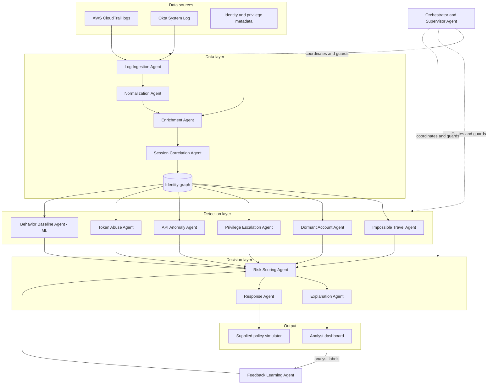

### 8.2 Architecture layers

| Layer | Purpose | Agents |
|---|---|---|
| Data | Read, clean, enrich and link events into sessions and an identity graph | 1 to 4 |
| Detection | Specialist detectors, one per attack pattern, plus ML anomaly detection | 5 to 10 |
| Decision | Score, explain and respond | 11 to 13 |
| Learning | Improve scoring from analyst feedback | 14 |
| Oversight | Coordinate, deduplicate, enforce safety rules, track metrics | 15 |

### 8.3 Design principles

1. **Never trust, always verify:** every session is scored continuously, not only at login.
2. **Sequences over single events:** combinations of events matter more than any one event.
3. **Explain everything:** no alert without evidence.
4. **Proportionate response:** the least disruptive action that sufficiently reduces risk.
5. **Modular detectors:** a new attack pattern is a new agent, without changing the rest.
6. **Secure by design:** the detection system itself follows least privilege and is auditable.

---

## 9. Multi-agent design (15 agents)

### 9.1 Agent catalogue

| # | Agent | Layer | Input | Output | Permissions |
|---|---|---|---|---|---|
| 1 | Log Ingestion Agent | Data | Raw CloudTrail and Okta files | Time-ordered event stream | Read raw logs |
| 2 | Normalization Agent | Data | Raw events | Unified event schema | Read/write event store |
| 3 | Enrichment Agent | Data | Unified events, metadata | Events with geo, ASN, device, privilege, sensitivity tags | Read metadata |
| 4 | Session Correlation Agent | Data | Enriched events | Sessions linking Okta login to AWS activity; identity graph | Write graph |
| 5 | Impossible Travel Agent | Detection | Login events per identity | P1 signals | Read only |
| 6 | Dormant Account Agent | Detection | Identity activity history | P2 signals | Read only |
| 7 | Privilege Escalation Agent | Detection | Session event sequences, graph | P3 signals and chain objects | Read only |
| 8 | API Anomaly Agent | Detection | API events, identity history | P4 signals | Read only |
| 9 | Token Abuse Agent | Detection | Session and token events | P5 signals | Read only |
| 10 | Behavior Baseline Agent | Detection | Feature vectors | Anomaly scores per event and session | Read only |
| 11 | Risk Scoring Agent | Decision | All signals, context | Identity and session risk scores, confidence, blast radius | Write scores |
| 12 | Explanation Agent | Decision | Scores, signals, evidence IDs | Human-readable explanation, counterfactuals, MITRE tags | Read only |
| 13 | Response Agent | Decision | Risk scores, friction budget | Recommended and simulated actions | Call simulator only |
| 14 | Feedback Learning Agent | Learning | Analyst labels | Updated scoring weights | Write weights |
| 15 | Orchestrator and Supervisor Agent | Oversight | All agent messages | Coordination, deduplicated alerts, audit log, metrics | Admin of agent system |

### 9.2 Agent interaction sequence

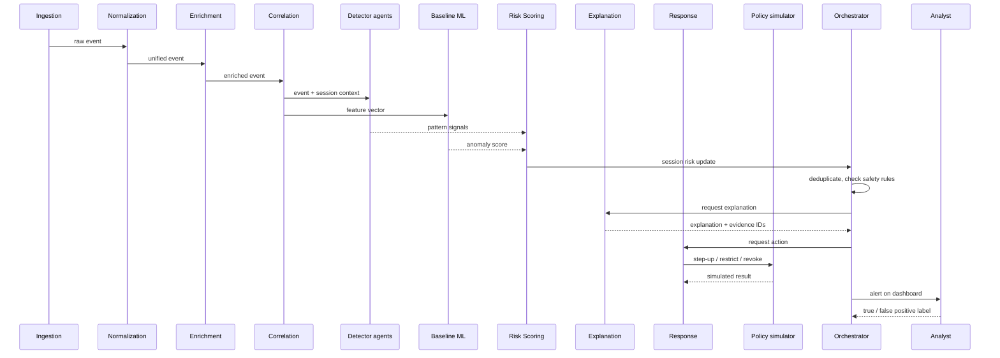

### 9.3 Agent communication

- Agents exchange messages through an in-process message bus (a Python queue for the hackathon; Kafka in future).
- Each message carries: `message_id`, `agent_id`, `timestamp`, `session_id`, `payload`, `evidence_event_ids`.
- Every agent decision is written to a hash-chained audit log by the Orchestrator.

### 9.4 Why multiple agents

| Benefit | Explanation |
|---|---|
| Independence | Each detector can be developed, tested and tuned in parallel by different team members |
| Extensibility | A new attack pattern is a new agent with the same interface |
| Explainability | Each signal is traceable to one agent with one clear reason |
| Least privilege | Each agent receives only the permissions it needs |
| Resilience | If one detector fails, others continue; the Orchestrator reports the gap |

---

## 10. Data design

### 10.1 Data sources

| Source | Key fields used |
|---|---|
| AWS CloudTrail | eventTime, eventName, eventSource, awsRegion, sourceIPAddress, userAgent, userIdentity (type, arn, accessKeyId, sessionContext), requestParameters, errorCode |
| Okta System Log | published, eventType, actor (id, alternateId), client (ipAddress, geographicalContext, userAgent, device), authenticationContext (externalSessionId), outcome |
| Identity metadata | user, groups, roles, attached policies, privilege level, last activity |
| Labeled samples | event labels and attack type for training and validation |
| Normal-activity examples | baseline behavior per identity |

### 10.2 Unified event schema

| Field | Type | Description |
|---|---|---|
| event_id | string | Original log event ID (used as evidence) |
| source | enum | `cloudtrail` or `okta` |
| timestamp | datetime (UTC) | Event time |
| identity_id | string | Canonical identity after mapping |
| session_id | string | Correlated session identifier |
| action | string | Normalized action (e.g., `login`, `iam:AttachUserPolicy`) |
| category | enum | `auth`, `session`, `api` |
| outcome | enum | `success`, `failure` |
| src_ip | string | Source IP |
| geo_country, geo_city, lat, lon | string/float | Enriched location |
| asn | string | Network owner |
| user_agent, device_id | string | Client details |
| resource | string | Target resource ARN or app |
| resource_sensitivity | int 1 to 5 | Enriched sensitivity |
| privilege_level | int 1 to 5 | Identity privilege at event time |

### 10.3 Identity graph

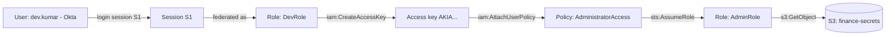

- **Nodes:** users, sessions, roles, access keys, policies, resources, IPs, devices.
- **Edges:** logins, federation, actions, grants, role assumptions, resource access.
- **Use:** privilege-path analysis, blast-radius computation and chain reconstruction.

### 10.4 Identity correlation logic

1. Map Okta `actor.alternateId` (email) to AWS identity via SAML/federation `roleSessionName` or user name.
2. Link Okta `externalSessionId` to AWS sessions whose start time falls within the Okta session window and whose source IP matches.
3. Link access keys to the identity that created them through `CreateAccessKey` events.
4. Assign a canonical `identity_id` and `session_id` to every event.

---

## 11. Detection logic for the five attack patterns

### 11.1 P1: Impossible travel (Agent 5)

```
for each identity, consecutive successful logins L1, L2:
    distance_km = haversine(L1.lat, L1.lon, L2.lat, L2.lon)
    hours = (L2.time - L1.time) in hours
    speed = distance_km / max(hours, 0.01)
    if speed > 900 km/h and not same_corporate_vpn_asn(L1, L2):
        emit signal P1, severity scaled by speed
```

False-positive controls: known VPN/corporate ASNs, mobile carrier IP jumps within a country.

### 11.2 P2: Dormant-account reactivation (Agent 6)

```
for each identity:
    idle_days = event.time - last_activity_before(event)
    if idle_days >= 30 and event.outcome == success:
        severity = high if privilege_level >= 4 else medium
        emit signal P2
        mark session as "reactivated" for 24 hours (boosts follow-on signals)
```

### 11.3 P3: Privilege-escalation chains (Agent 7)

Escalation steps are modeled as states. A chain is a sequence within one identity (across sessions linked by the graph) within a time window, for example 6 hours.

| Step type | Example API actions |
|---|---|
| Credential creation | `CreateAccessKey`, `CreateLoginProfile`, `UpdateLoginProfile` |
| Identity creation | `CreateUser`, `CreateRole` |
| Permission grant | `AttachUserPolicy`, `AttachRolePolicy`, `PutUserPolicy`, `AddUserToGroup` |
| Trust change | `UpdateAssumeRolePolicy` |
| Privilege use | `AssumeRole` into a higher-privilege role, `PassRole` |
| Impact | Access to high-sensitivity resources, `GetSecretValue`, disabling logging |

```
for each session sequence:
    match ordered subsequence against escalation step types
    if at least 2 steps matched and privilege increased:
        build chain object (ordered event IDs, start/end privilege)
        emit signal P3 with chain length and privilege delta
```

### 11.4 P4: Unusual API calls (Agent 8)

```
for each API event:
    rarity = 1 - frequency(identity, action) / total_actions(identity)
    peer_rarity = 1 - frequency(peer_group, action) / total(peer_group)
    new_region = region not in identity_history
    if (rarity > 0.98 and peer_rarity > 0.95) or new_region or sensitive_action:
        emit signal P4
```

Sensitive actions include `StopLogging`, `DeleteTrail`, `PutBucketPolicy`, `GetSecretValue` and `CreateAccessKey` for another user.

### 11.5 P5: Token or session abuse (Agent 9)

```
for each session token / session_id:
    if token used from IP or ASN different from session origin: emit P5
    if user_agent or device changes mid-session: emit P5
    if token used after Okta session end or logout event: emit P5 (high)
    if same token used concurrently from two locations: emit P5 (high)
```

### 11.6 MITRE ATT&CK mapping

| Pattern | MITRE technique |
|---|---|
| P1 Impossible travel | T1078 Valid Accounts |
| P2 Dormant reactivation | T1078.004 Valid Accounts: Cloud Accounts |
| P3 Privilege escalation | T1098 Account Manipulation; T1548 Abuse Elevation Control Mechanism |
| P4 Unusual API calls | T1526 Cloud Service Discovery; T1562 Impair Defenses (for logging changes) |
| P5 Token/session abuse | T1550 Use Alternate Authentication Material; T1539 Steal Web Session Cookie |

---

## 12. Machine learning design

### 12.1 ML overview

Rules give precision and explainability for known patterns. Machine learning adds coverage for behavior that does not match a rule but deviates from what is normal for that identity or its peers. IdentityShield uses a **hybrid** approach.

| ML component | Model | Purpose |
|---|---|---|
| M1 Behavior anomaly | Isolation Forest (per peer group) | Score how unusual an event or session is |
| M2 Peer-group clustering | K-Means on role and activity profiles | Baseline new or sparse users against similar users |
| M3 Attack-chain predictor | First-order Markov model over escalation states | Predict the next likely step and its probability |
| M4 Risk calibration model | Logistic regression (or gradient boosting) on signals | Convert signals into a calibrated probability of compromise |
| M5 Feedback adaptation | Online weight update from analyst labels | Adapt risk weights to the environment |

### 12.2 End-to-end ML pipeline

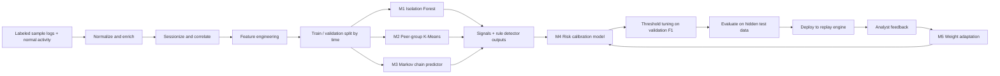

### 12.3 Feature engineering

| Group | Feature | Level |
|---|---|---|
| Time | hour of day, day of week, deviation from user's usual hours | Event |
| Location | country change, distance from last login, travel speed, new ASN flag | Event |
| Device | new device flag, user-agent change within session | Event, session |
| Activity | action frequency for user, action rarity vs peers, new service, new region | Event |
| Privilege | privilege level, privilege delta in session, number of IAM write actions | Session |
| Sensitivity | max and mean resource sensitivity accessed | Session |
| Dormancy | days since last activity | Identity |
| Volume | events per minute, distinct APIs per session, error rate | Session |
| Sequence | escalation chain length, Markov transition probability | Session |
| Graph | number of reachable high-sensitivity resources (blast radius) | Identity |

### 12.4 M1: Isolation Forest anomaly model

- **Why:** unsupervised, works with mostly normal data, fast, few hyperparameters.
- **Training data:** normal-activity examples only.
- **Input:** session-level feature vectors (and event-level for API events).
- **Output:** anomaly score normalized to 0 to 1.
- **Hyperparameters:** `n_estimators = 200`, `contamination` tuned on validation, `max_samples = auto`.

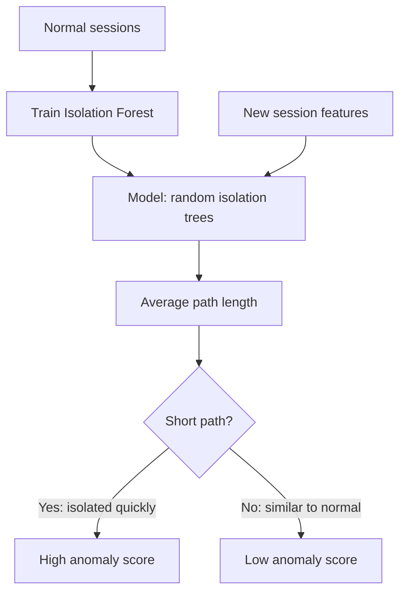

Intuition: unusual sessions are easier to isolate, so they need fewer random splits and get shorter average path lengths.

### 12.5 M2: Peer-group baselining

- Cluster identities on role, group membership and typical services used.
- A new or rarely active identity is compared against its peer cluster's baseline.
- This addresses the **cold-start problem** and catches "a developer suddenly using IAM admin actions".

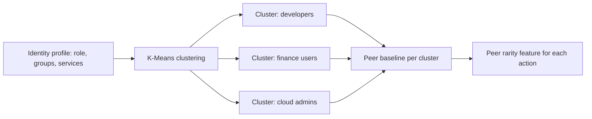

### 12.6 M3: Attack-chain predictor

Escalation is modeled as a sequence of states. Transition probabilities are learned from labeled escalation chains in the sample data.

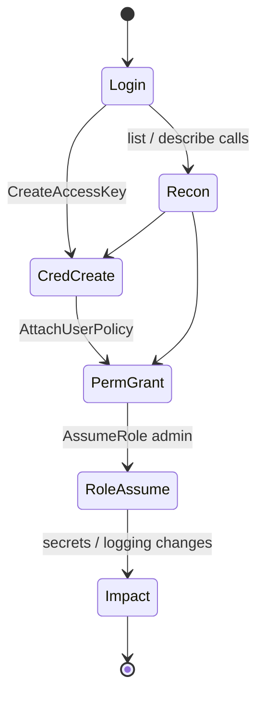

- **Prediction:** given current state, predict the most probable next state, e.g., after `PermGrant`, `RoleAssume` is likely.
- **Use:** raise risk *before* the final step and show "Predicted next step: AssumeRole into AdminRole (high likelihood)" on the alert.
- **Fallback:** if training chains are too few, use expert-defined transition weights.

### 12.7 M4: Risk calibration model

- **Input:** rule signals (P1 to P5 as binary and severity), M1 anomaly score, M3 chain probability, privilege level, resource sensitivity.
- **Model:** logistic regression, chosen for speed, calibrated output and interpretable coefficients.
- **Label:** malicious vs benign session from labeled samples.
- **Output:** probability of compromise, combined into the final risk score (Section 13).

### 12.8 Training and validation strategy

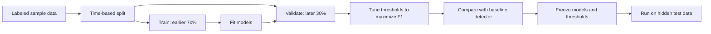

- **Time-based split** prevents leaking future behavior into training.
- **No tuning on hidden data.**
- **Class imbalance:** use class weights in M4 and precision-recall curves for thresholds rather than accuracy.

### 12.9 Model evaluation metrics

| Metric | Use |
|---|---|
| Precision, recall, F1 | Primary event and session metrics |
| PR-AUC | Threshold-independent comparison with the baseline |
| Confusion matrix per attack pattern | Find weak detectors |
| Detection latency | Time from event to alert under load |
| Chain reconstruction accuracy | Correct order and completeness of escalation chains |

---

## 13. Risk scoring model

### 13.1 Scoring formula

For each session *s*:

```
base(s)      = sum over signals i of ( w_i x severity_i )  +  w_ml x anomaly_score(s)
context(s)   = privilege_multiplier(s) x sensitivity_multiplier(s)
combo(s)     = 1 + 0.25 x (number of distinct patterns observed - 1)
chain(s)     = 1 + chain_probability(next step reaches admin)
raw(s)       = base(s) x context(s) x combo(s) x chain(s)
risk(s)      = 100 x calibrated_probability(raw(s), M4)          range 0 to 100
identity_risk = max(session risks over last 24 h) with decay
```

| Component | Values |
|---|---|
| Privilege multiplier | Standard user 1.0, power user 1.3, admin 2.0 |
| Sensitivity multiplier | Low 1.0, medium 1.2, high (IAM, secrets, finance data) 1.5 |
| Combination bonus | Rewards multiple patterns in one session (sequences over single events) |
| Initial weights w_i | Expert defaults; updated by feedback (M5) |

### 13.2 Risk scoring flow

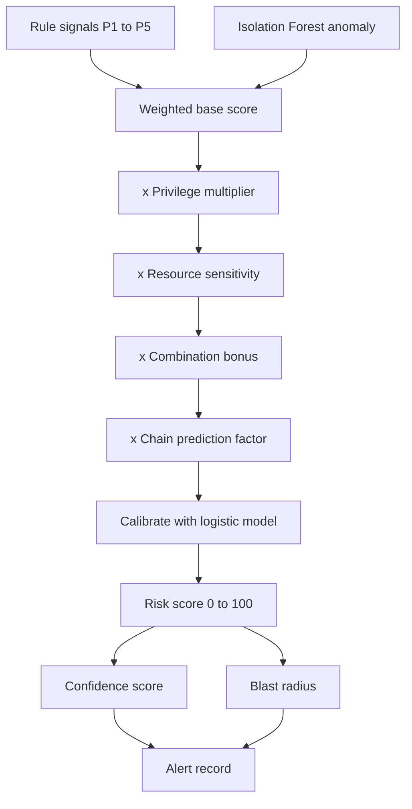

### 13.3 Confidence score

Confidence reflects how much evidence supports the score:

```
confidence = min(1, events_in_session / 10) x detector_agreement
detector_agreement = fraction of signals pointing in the same direction
```

An alert "Risk 85, confidence low" tells the analyst to verify before acting.

### 13.4 Blast radius

Using the identity graph, blast radius = the count and sensitivity of resources reachable by the identity's current permissions and assumable roles. Alerts are sorted by **risk x blast radius** so the most damaging possible compromise is investigated first.

### 13.5 Risk decay

```
risk(t) = risk(t0) x e^( -lambda x hours_since_last_suspicious_event )
```

With a half-life of about 6 hours, a user whose behavior returns to normal is not labeled risky indefinitely. Confirmed malicious sessions do not decay until resolved by an analyst.

### 13.6 Feedback adaptation (M5)

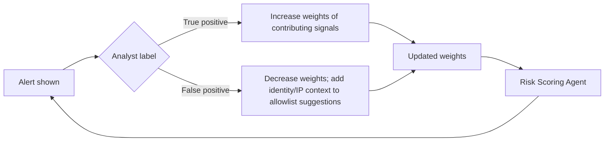

Update rule (bounded):

```
w_i = clip( w_i + eta x (label - predicted_probability) x signal_i , w_min, w_max )
```

Bounds prevent a few labels from disabling a detector entirely.

---

## 14. Explainability design

### 14.1 Explanation structure

Every alert answers four questions:

| Question | Example |
|---|---|
| What happened? | Dormant account `svc-report` logged in after 47 days, created an access key, attached AdministratorAccess and assumed AdminRole within 38 minutes |
| Why does it matter? | The identity gained full administrative access to the AWS account, including finance data |
| What evidence supports it? | Okta event `okta-8f1...`, CloudTrail events `ct-1a2...`, `ct-1a7...`, `ct-1b0...` |
| What should be done? | Revoke session S-4412 and disable the new access key (simulated) |

### 14.2 Counterfactual explanation

The Explanation Agent recomputes the score with each major signal removed:

| If this signal were absent | Score would be |
|---|---|
| New-country login | 52 |
| Dormant reactivation | 61 |
| AttachUserPolicy step | 44 |
| All present (actual) | 92 |

This shows exactly which signal drives the decision and supports the "explanation quality" KPI.

### 14.3 Evidence traceability

- Every signal carries the original `event_id` values that triggered it.
- The dashboard links each evidence ID to the raw log record.
- The audit log stores which agent produced which signal, when and from which evidence.

### 14.4 Optional LLM summary

An optional LLM can turn the structured explanation into plain English. Log fields are passed as quoted data only, never as instructions, to prevent log-injection attacks (Section 17).

---

## 15. Response and policy simulation

### 15.1 Response policy

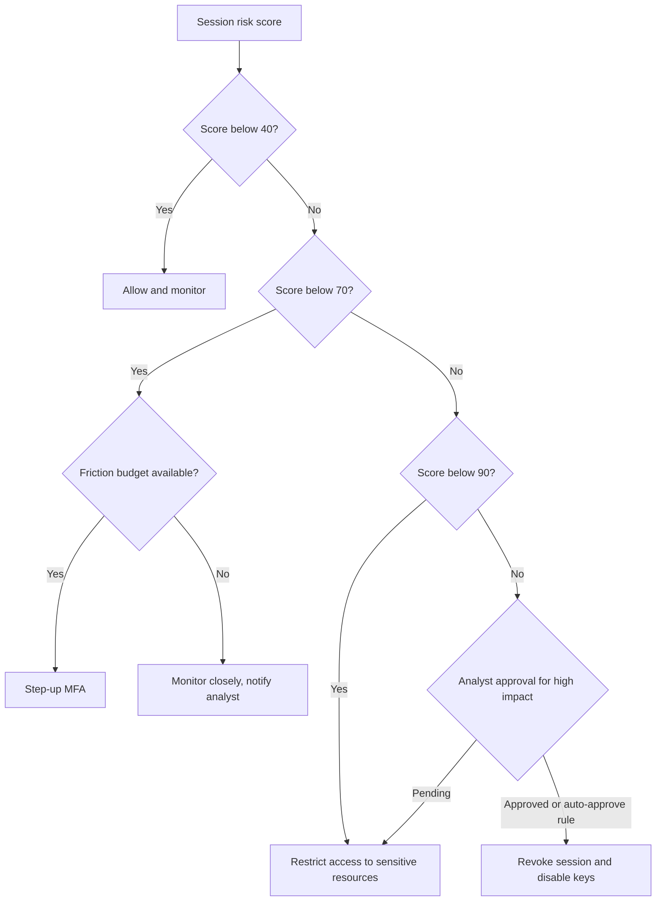

### 15.2 Action catalogue

| Action | When | Simulator call |
|---|---|---|
| Monitor | Score < 40 | None; logged |
| Step-up authentication | 40 to 69 | `simulator.step_up(session_id, method)` |
| Restrict access | 70 to 89 | `simulator.restrict(identity_id, scope)` |
| Revoke session / disable key | 90+ (with approval) | `simulator.revoke(session_id)`, `simulator.disable_key(key_id)` |

Simulator method names are placeholders and will match the supplied interface.

### 15.3 Friction budget

- Each genuine user has a daily budget of step-up prompts (e.g., 2 per day).
- Once exhausted, medium-risk events produce analyst notifications instead of more prompts, unless risk rises to the restrict band.
- This directly targets the stretch goal of balancing security risk against unnecessary user disruption and prevents **MFA fatigue**, which attackers themselves exploit.

### 15.4 Safety guard

The Orchestrator verifies every outgoing action:

1. Target must be the supplied simulator endpoint.
2. Action must be on the allowlist.
3. High-impact actions require analyst approval or a pre-approved rule.
4. Every action is written to the audit log.

---

## 16. Unique features

| Feature | Description | Value |
|---|---|---|
| Attack-chain prediction | Predicts the next escalation step before it happens | Proactive, not reactive |
| Blast radius score | Shows what a compromised identity can reach right now | Prioritizes by real impact |
| Counterfactual explanations | Shows how the score changes without each signal | Trust and transparency |
| Friction budget | Limits step-up prompts for genuine users | Better user experience, avoids MFA fatigue |
| Risk decay | Scores fade as behavior returns to normal | Fewer stale alerts |
| Confidence score | States how certain each score is | Better analyst decisions |
| Peer-group baselining | Compares identities with similar roles | Solves cold start |
| Honeytoken detection | Decoy keys or roles in the simulator; any use is a confirmed attack | Near-zero false positives |
| Privilege hygiene report | Lists dormant admins and unused permissions | Prevention, not only detection |
| Attack timeline replay | Step-by-step replay on the identity graph | Fast investigation; strong demo |
| MITRE ATT&CK mapping | Each alert tagged with a technique | Industry-standard language |
| Auto incident report | One-click report with timeline, evidence and actions | Saves analyst time |
| Secured agent system | Least privilege, hash-chained audit, human approval | The defender is not the weak link |

---

## 17. Security layer for the agent system

A detection system with response powers is itself a high-value target. IdentityShield applies Zero Trust to its own agents.

### 17.1 Security architecture

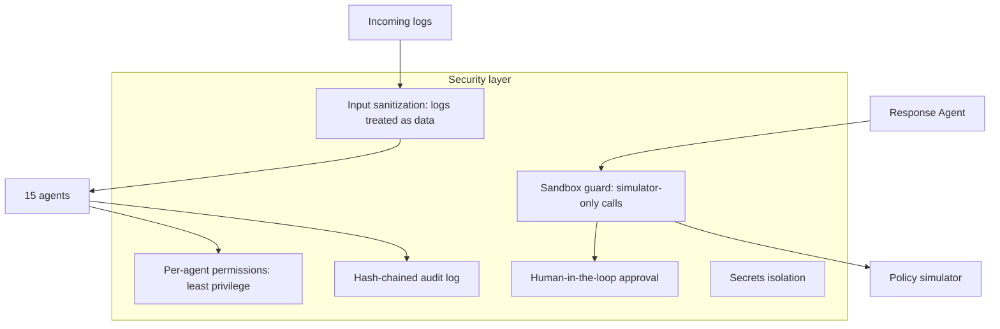

### 17.2 Controls

| Control | Implementation |
|---|---|
| Least privilege per agent | Detector agents have read-only access; only the Response Agent may call the simulator; only the Feedback Agent may change weights |
| Tamper-evident audit log | Each entry stores `hash = SHA256(previous_hash + entry)`; any edit breaks the chain and is detected |
| Sandbox guard | Outbound call allowlist with only the simulator endpoint; all other network calls blocked |
| Human approval | Revoke and disable-key actions require analyst confirmation unless pre-approved |
| Log-injection defense | Log fields (user agents, names) escaped and passed as data; never executed or used as LLM instructions |
| Secrets isolation | API keys in environment variables; never logged or shown on the dashboard |
| Dashboard authentication | Analyst login with role-based access (viewer vs responder) |
| Integrity of models | Model files hashed at load; mismatch blocks startup |

---

## 18. Dashboard and user experience

### 18.1 Screens

| Screen | Contents |
|---|---|
| Overview | Active alerts by risk band, top risky identities, metrics (precision, recall, F1 vs baseline), detection latency |
| Alert queue | One row per session alert: identity, risk, confidence, blast radius, patterns, MITRE tags, recommended action |
| Alert detail | Explanation, counterfactual table, evidence events with links, predicted next step, action buttons, feedback buttons |
| Identity attack graph | Interactive graph of the identity's sessions, roles, keys and resources with the escalation path highlighted |
| Timeline replay | Slider replaying the attack step by step |
| Privilege hygiene | Dormant admin accounts, unused high-risk permissions, escalation paths to admin |
| Audit log | Agent decisions and actions with chain-verification status |

### 18.2 Alert card example

```
[CRITICAL] Risk 92 | Confidence high | Blast radius: 14 high-sensitivity resources
Identity: svc-report   Session: S-4412   MITRE: T1078.004, T1098
Patterns: Dormant reactivation, Privilege escalation chain, Impossible travel
Predicted next step: Access to finance-secrets bucket (high likelihood)
Recommended: Revoke session S-4412, disable key AKIA...XYZ  [Approve] [Modify]
Feedback: [True positive] [False positive]
```

### 18.3 UX principles

- One alert per session, not per event.
- The most important information (risk, why, action) appears first.
- Every number on screen is clickable down to the evidence.

---

## 19. Functional requirements

| ID | Requirement | Priority |
|---|---|---|
| FR-01 | Ingest CloudTrail and Okta log files and replay them in time order | Must |
| FR-02 | Normalize events from both sources into the unified schema | Must |
| FR-03 | Enrich events with geo-IP, ASN, privilege level and resource sensitivity | Must |
| FR-04 | Correlate Okta sessions with AWS activity and build the identity graph | Must |
| FR-05 | Detect impossible travel | Must |
| FR-06 | Detect dormant-account reactivation | Must |
| FR-07 | Detect privilege-escalation chains and reconstruct ordered steps | Must |
| FR-08 | Detect unusual API calls using identity and peer baselines | Must |
| FR-09 | Detect token and session abuse | Must |
| FR-10 | Compute ML anomaly scores with Isolation Forest | Should |
| FR-11 | Compute risk score per identity and per session | Must |
| FR-12 | Produce event-level and session-level outputs separately | Must |
| FR-13 | Generate explanations with evidence event IDs for every alert | Must |
| FR-14 | Generate counterfactual explanations | Should |
| FR-15 | Map alerts to MITRE ATT&CK techniques | Should |
| FR-16 | Recommend step-up, restrict or revoke actions | Must |
| FR-17 | Execute actions only through the supplied simulator | Must |
| FR-18 | Enforce friction budget for step-up prompts | Should |
| FR-19 | Accept analyst feedback and update weights | Should |
| FR-20 | Predict next attack-chain step | Could |
| FR-21 | Compute blast radius | Could |
| FR-22 | Visualize identity attack graph and timeline replay | Should |
| FR-23 | Produce privilege hygiene report | Could |
| FR-24 | Maintain hash-chained audit log of agent decisions | Should |
| FR-25 | Report precision, recall, F1 and latency against the baseline | Must |
| FR-26 | Generate incident report export | Could |

---

## 20. Non-functional requirements

| ID | Category | Requirement |
|---|---|---|
| NFR-01 | Performance | Meet detection latency under the published load profile during replay |
| NFR-02 | Scalability | Process events in time windows; design supports streaming (Kafka) later |
| NFR-03 | Accuracy | Exceed baseline F1 at event level and session alert precision |
| NFR-04 | Explainability | 100% of alerts include reason and evidence IDs |
| NFR-05 | Security | Least privilege per agent; simulator-only enforcement; audit log integrity |
| NFR-06 | Reliability | Failure of one detector does not stop the pipeline; Orchestrator reports it |
| NFR-07 | Usability | Analyst can understand an alert within 30 seconds |
| NFR-08 | Portability | Runs on a single laptop with Python; no paid services required |
| NFR-09 | Maintainability | New detector added by implementing one agent interface |
| NFR-10 | Privacy | Personal data limited to what detection needs; secrets never logged |

---

## 21. Evaluation plan

### 21.1 Evaluation flow

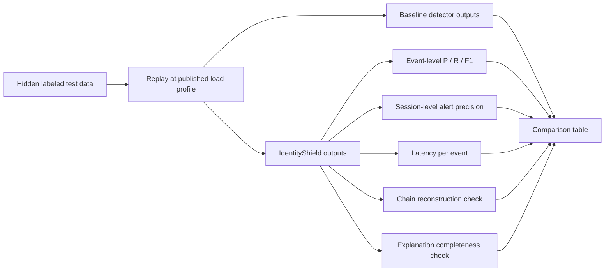

### 21.2 Evaluation table (filled during the hackathon)

| Metric | Baseline | IdentityShield | Improvement |
|---|---|---|---|
| Event precision | TBD | TBD | TBD |
| Event recall | TBD | TBD | TBD |
| Event F1 | TBD | TBD | TBD |
| Session alert precision | TBD | TBD | TBD |
| Median latency | TBD | TBD | TBD |
| Chains reconstructed | TBD | TBD | TBD |

### 21.3 Ablation study

To prove each component adds value, measure F1 with:

1. Rules only
2. Rules + Isolation Forest
3. Rules + Isolation Forest + context multipliers
4. Full system with combination and chain factors

### 21.4 Per-pattern analysis

A confusion matrix per attack pattern (P1 to P5) identifies the weakest detector for tuning.

---

## 22. Competitive differentiation

| Capability | Cloud-native threat detection (e.g., AWS GuardDuty) | IdP risk tools (e.g., Okta identity threat features) | SIEM (e.g., Splunk, Microsoft Sentinel) | IdentityShield |
|---|---|---|---|---|
| Scope | Cloud activity | Login and session side | All logs | Login + cloud activity, correlated |
| Cross-platform identity story | Limited, siloed | Limited, siloed | Possible with custom rules | Built in via identity graph |
| Multi-step chain reconstruction | Partial | Not the focus | Manual queries | Automatic, ordered, visualized |
| Next-step prediction | No | No | No by default | Yes (Markov model) |
| Context-aware scoring | Partial | Partial | Custom | Privilege x sensitivity x blast radius |
| Counterfactual explanations | No | No | No | Yes |
| Graduated response with friction budget | No | Partial (risk-based MFA) | Via add-on automation | Yes |
| Learns from analyst feedback | Limited | Limited | Custom | Built in |
| Cost and setup | Paid per volume | Paid add-on | Expensive, needs staff | Open-source, laptop-ready |

Notes: comparisons are general and based on typical usage; vendor products evolve and some capabilities can be added through custom configuration. The key differentiation is that IdentityShield combines these capabilities in one explainable, low-cost system focused on identity abuse.

**One-line pitch:** Existing tools watch the login or the cloud separately; IdentityShield connects both into one explainable story of what a compromised identity did, predicts what it will do next, and responds with just enough friction.

---

## 23. Technology stack

| Layer | Technology | Reason |
|---|---|---|
| Language | Python 3.11 | Fast development, strong data and ML libraries |
| Data processing | pandas, NumPy | Log parsing and feature engineering |
| Graph | NetworkX | Identity graph, path and blast-radius analysis |
| ML | scikit-learn (IsolationForest, KMeans, LogisticRegression) | Lightweight, explainable models |
| Sequence model | Custom Markov model in Python | Simple, fast, interpretable |
| Geo-IP | MaxMind GeoLite2 offline database | Offline enrichment |
| Agents and bus | Python classes + `queue` / asyncio | Simple multi-agent orchestration |
| API | FastAPI | Backend endpoints for dashboard and simulator calls |
| Dashboard | Streamlit + PyVis / Plotly | Rapid UI with graphs and timelines |
| Storage | SQLite / Parquet | Lightweight, no server needed |
| Audit | hashlib SHA-256 | Tamper-evident log |
| Optional LLM | Any hosted LLM API | Plain-English alert summaries |
| Version control | Git + GitHub | Team collaboration |

---

## 24. Implementation plan (10 hours)

### 24.1 Timeline

```mermaid
gantt
    title IdentityShield 10-hour build plan
    dateFormat HH:mm
    axisFormat %H:%M
    section Data
    Ingestion and normalization        :a1, 00:00, 2h
    Enrichment and correlation         :a2, after a1, 2h
    section Detection
    Study dataset and attack labels    :b1, 00:00, 2h
    Five rule detectors                :b2, after b1, 3h
    Isolation Forest and peer groups   :b3, 04:00, 2h
    section Decision
    Risk scoring and explanations      :c1, 05:00, 2h
    Policy simulator integration       :c2, 06:00, 1h
    section Dashboard
    Streamlit skeleton                 :d1, 00:00, 2h
    Alert views and attack graph       :d2, after d1, 3h
    Feedback and timeline replay       :d3, 05:00, 2h
    section Evaluation and demo
    Metrics vs baseline and tuning     :e1, 07:00, 1.5h
    Code freeze, demo script, slides   :e2, 08:30, 1.5h
```

### 24.2 Team allocation

| Member | Responsibilities |
|---|---|
| Member A: Data engineer | Agents 1 to 4, unified schema, identity graph |
| Member B: Detection engineer | Agents 5 to 9, MITRE mapping, chain reconstruction |
| Member C: ML engineer | Agents 10 to 12 and 14, risk model, evaluation metrics |
| Member D: Frontend and demo | Dashboard, Agent 13 simulator integration, Agent 15 orchestration, demo |

### 24.3 Priority order (MoSCoW)

1. **Must:** ingestion, normalization, correlation, five detectors, risk score, explanations with evidence, simulator integration, metrics vs baseline.
2. **Should:** Isolation Forest, counterfactuals, MITRE tags, friction budget, attack graph, feedback, audit log.
3. **Could:** chain prediction, blast radius, timeline replay, hygiene report, incident report, LLM summary.

### 24.4 Checkpoints

| Hour | Checkpoint |
|---|---|
| 2 | Unified events loaded; dashboard skeleton runs |
| 5 | All five detectors produce signals on sample data |
| 7 | End-to-end: alerts with scores, explanations and simulated actions |
| 8.5 | Metrics computed against baseline; code freeze |
| 10 | Demo rehearsed; slides ready |

---

## 25. Risks and mitigations

| Risk | Likelihood | Impact | Mitigation |
|---|---|---|---|
| Okta-to-AWS identity mapping is incomplete | Medium | High | Multiple mapping keys (email, role session name, IP + time window); unmapped events still scored at event level |
| High false positives from VPN or travel | Medium | Medium | ASN allowlist, peer baseline, confidence score, feedback |
| Not enough labeled chains for ML | High | Medium | Expert-defined transition weights as fallback |
| Overfitting to sample data | Medium | High | Time-based split; no tuning on hidden data; simple models |
| Latency under load | Low | Medium | Windowed batch processing; precomputed baselines |
| Time overrun | High | High | Strict MoSCoW priorities; checkpoints; rules before ML |
| Accidental call outside sandbox | Low | Critical | Orchestrator allowlist guard; no cloud credentials in environment |
| Log injection into LLM summary | Low | Medium | Treat logs as data; optional feature can be disabled |
| Team integration issues | Medium | Medium | Agree on unified schema and message format in hour 0 |

---

## 26. Demo walkthrough

### 26.1 Scenario

1. **09:02** Okta login by `svc-report` from Mysuru, India (normal history).
2. **09:40** Same account logs in from an overseas IP. *Impossible travel (P1).* The account had been idle for 47 days before 09:02. *Dormant reactivation (P2).*
3. **09:44** CloudTrail `CreateAccessKey` for `svc-report`. *Escalation step 1.*
4. **09:51** `AttachUserPolicy` with `AdministratorAccess`. *Escalation step 2.* The chain predictor shows: "Next likely: AssumeRole into AdminRole."
5. **09:55** `AssumeRole` into `AdminRole`. *Chain complete (P3).*
6. **09:58** `GetSecretValue` from a region never used before. *Unusual API (P4).*

### 26.2 What the system shows

| Time | Risk | Action |
|---|---|---|
| 09:40 | 58 | Step-up MFA requested via simulator |
| 09:51 | 81 | Access to sensitive resources restricted; analyst notified with predicted next step |
| 09:55 | 94 | Revoke session recommended; analyst approves; session revoked and key disabled in simulator |

### 26.3 Demo talking points

- "Every login succeeded; failed-login rules saw nothing."
- "We connected Okta and AWS into one story and warned before the admin role was assumed."
- "Every alert shows exactly which log events prove it, and what would lower the score."
- "A genuine employee travelling for work would get at most one MFA prompt, thanks to the friction budget."
- "All actions went only through the supplied simulator, as the rules require."

---

## 27. Future scope

1. Real-time streaming with Kafka and Flink.
2. More identity sources: Azure Entra ID, Google Workspace, GitHub.
3. Graph neural networks for privilege-path risk.
4. Sequence models (LSTM or transformer) for richer behavior modeling.
5. LLM-based analyst copilot for natural-language queries ("show sessions touching IAM after midnight").
6. Integration with Indian regulatory reporting requirements (e.g., CERT-In incident reporting timelines).
7. Passkey and deepfake-resistant step-up methods.
8. Multi-language alerts (Kannada, Hindi) for small organizations without dedicated SOC staff.

---

## 28. Glossary

| Term | Meaning |
|---|---|
| ASN | Autonomous System Number; identifies the network owner of an IP |
| Blast radius | Resources an identity can reach with its current permissions |
| CloudTrail | AWS service that records API activity |
| Counterfactual | "What would change if this factor were absent" explanation |
| F1 score | Harmonic mean of precision and recall |
| Friction budget | Limit on how often a genuine user is asked for extra verification |
| Honeytoken | A decoy credential whose use reveals an attacker |
| IdP | Identity provider, such as Okta |
| Isolation Forest | Unsupervised ML model that detects anomalies by isolating points |
| ITDR | Identity Threat Detection and Response |
| Markov model | Model predicting the next state from the current state |
| MFA | Multi-factor authentication |
| MITRE ATT&CK | Public knowledge base of attacker techniques |
| Precision | Fraction of alerts that are correct |
| Recall | Fraction of real attacks that are detected |
| SIEM | Security Information and Event Management |
| Step-up authentication | Asking for additional verification during a session |
| Zero Trust | Security model that never assumes trust and always verifies |

---

## 29. Appendices

### Appendix A: Unified event example (JSON)

```json
{
  "event_id": "ct-1a7f",
  "source": "cloudtrail",
  "timestamp": "2026-10-28T09:51:12Z",
  "identity_id": "svc-report",
  "session_id": "S-4412",
  "action": "iam:AttachUserPolicy",
  "category": "api",
  "outcome": "success",
  "src_ip": "203.0.113.45",
  "geo_country": "XX",
  "asn": "AS64500",
  "user_agent": "aws-cli/2.x",
  "resource": "arn:aws:iam::policy/AdministratorAccess",
  "resource_sensitivity": 5,
  "privilege_level": 2
}
```

### Appendix B: Alert record example (JSON)

```json
{
  "alert_id": "AL-0091",
  "level": "session",
  "identity_id": "svc-report",
  "session_id": "S-4412",
  "risk": 94,
  "confidence": 0.9,
  "blast_radius": 14,
  "patterns": ["P1", "P2", "P3", "P4"],
  "mitre": ["T1078.004", "T1098"],
  "chain": ["ct-1a2c", "ct-1a7f", "ct-1b03"],
  "predicted_next_step": {"state": "Impact", "probability": "high"},
  "evidence_event_ids": ["okta-8f1d", "ct-1a2c", "ct-1a7f", "ct-1b03", "ct-1b19"],
  "explanation": "Dormant account reactivated from a new country and escalated to admin within 15 minutes.",
  "counterfactuals": {"without_P1": 52, "without_P2": 61, "without_P3": 44},
  "recommended_action": "revoke_session",
  "action_status": "approved_and_simulated"
}
```

### Appendix C: Backend API endpoints

| Method | Endpoint | Purpose |
|---|---|---|
| POST | `/replay/start` | Start log replay at a given speed |
| GET | `/alerts` | List alerts with filters (risk, pattern, level) |
| GET | `/alerts/{id}` | Alert detail with explanation and evidence |
| POST | `/alerts/{id}/feedback` | Submit true or false positive label |
| POST | `/alerts/{id}/action` | Approve or modify recommended action |
| GET | `/identities/{id}/graph` | Identity graph and escalation paths |
| GET | `/metrics` | Precision, recall, F1, latency vs baseline |
| GET | `/audit/verify` | Verify hash chain of the audit log |

### Appendix D: Agent interface (Python sketch)

```python
class Agent:
    name: str
    permissions: set[str]

    def handle(self, message: dict) -> list[dict]:
        """Receive a message, return zero or more output messages.
        Every output must include evidence_event_ids."""
        raise NotImplementedError


class ImpossibleTravelAgent(Agent):
    name = "impossible_travel"
    permissions = {"read:events"}

    def handle(self, message):
        event = message["payload"]
        if event["category"] != "auth" or event["outcome"] != "success":
            return []
        prev = self.last_login.get(event["identity_id"])
        self.last_login[event["identity_id"]] = event
        if prev is None:
            return []
        speed = travel_speed_kmh(prev, event)
        if speed > 900 and not same_vpn_asn(prev, event):
            return [{
                "type": "signal",
                "pattern": "P1",
                "severity": min(1.0, speed / 3000),
                "session_id": event["session_id"],
                "evidence_event_ids": [prev["event_id"], event["event_id"]],
            }]
        return []
```

### Appendix E: Hash-chained audit log

```python
import hashlib, json

def append_audit(log, entry):
    prev_hash = log[-1]["hash"] if log else "0" * 64
    body = json.dumps(entry, sort_keys=True)
    entry_hash = hashlib.sha256((prev_hash + body).encode()).hexdigest()
    log.append({"entry": entry, "prev_hash": prev_hash, "hash": entry_hash})

def verify_audit(log):
    prev = "0" * 64
    for row in log:
        body = json.dumps(row["entry"], sort_keys=True)
        if row["prev_hash"] != prev:
            return False
        if hashlib.sha256((prev + body).encode()).hexdigest() != row["hash"]:
            return False
        prev = row["hash"]
    return True
```

---

*End of document.*
