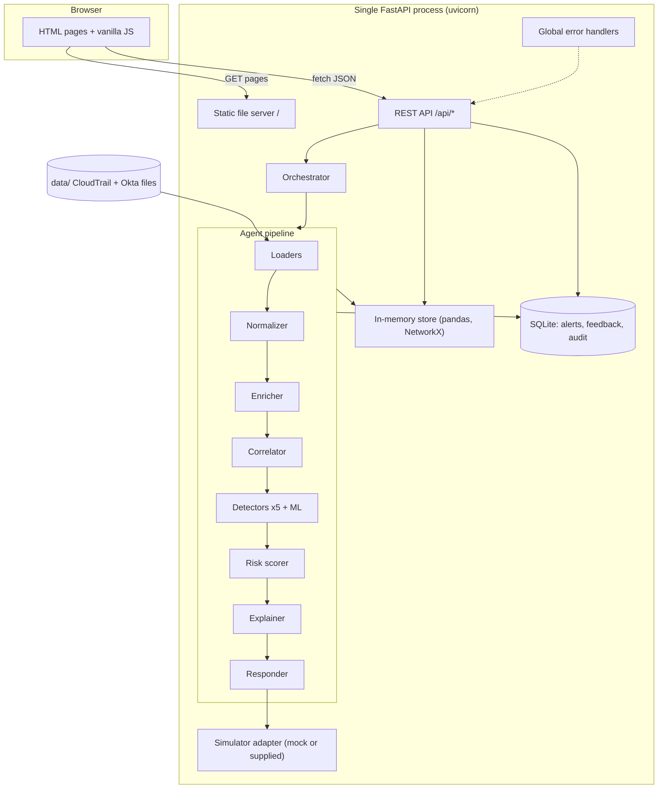
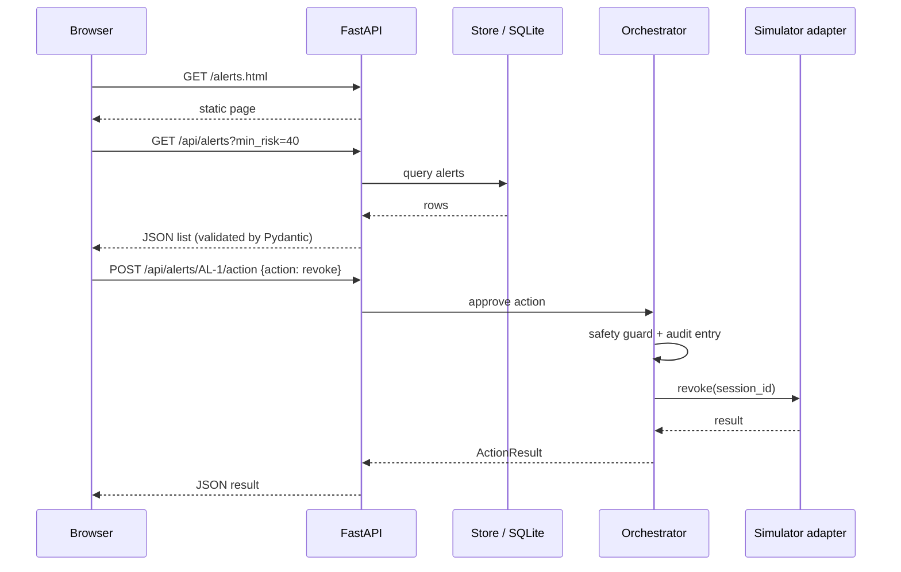
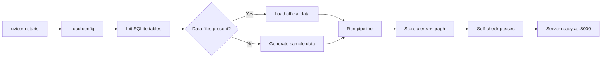
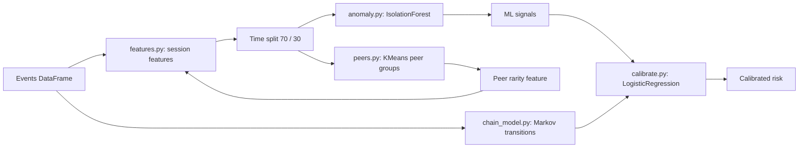
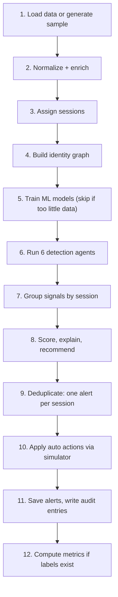
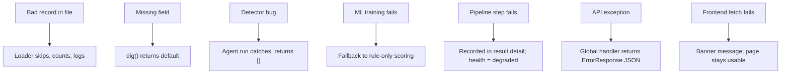

# IdentityShield: Technical PRD and Build Guide

**Product:** IdentityShield, a multi-agent identity threat detection website
**Track:** Track 2: Zero Trust for Everyone (Intelligent Identity Protection)
**Document type:** Technical Product Requirements Document
**Version:** 1.0 (28 October 2026)
**Build window:** 8 hours, generated with the Antigravity AI IDE
**Companion document:** IdentityShield_PRD.md (product and ML design)

---

## Table of contents

1. Purpose of this document
2. Build strategy for a slow AI IDE
3. Technology stack (pinned)
4. System architecture
5. Zero-error engineering rules
6. Project folder structure
7. Configuration
8. Data contracts (Pydantic models)
9. Data ingestion and normalization
10. Correlation and identity graph
11. Detection agents
12. ML module
13. Risk scoring, explanation and response
14. Orchestrator and pipeline
15. Storage design
16. REST API specification
17. Frontend website specification
18. Error handling design
19. Security implementation
20. Testing and verification
21. Run, build and deployment
22. Antigravity prompt pack (copy-paste)
23. 8-hour execution plan
24. Troubleshooting guide
25. Definition of done

---

## 1. Purpose of this document

This document tells the team **exactly what to build, in which files, with which libraries, and in what order**, so that the Antigravity AI IDE can generate the website quickly and with as few backend errors as possible.

It turns the product PRD into an engineering plan:

- One fixed technology stack with pinned versions.
- One folder structure that every prompt refers to.
- Fixed data contracts (schemas) that all modules share.
- Small, ordered prompts sized for a slow agent.
- Built-in verification after every step.

### 1.1 What the finished website does

| Page | Purpose |
|---|---|
| Overview | Risk summary, top risky identities, metrics vs baseline |
| Alerts | Session-level alert queue with risk, confidence, patterns, MITRE tags |
| Alert detail | Explanation, counterfactuals, evidence events, predicted next step, actions, feedback |
| Identity graph | Interactive graph of identity, sessions, roles, keys and resources |
| Timeline | Step-by-step replay of an attack chain |
| Hygiene | Dormant admin accounts and escalation paths |
| Audit | Agent decision log with hash-chain verification |

---

## 2. Build strategy for a slow AI IDE

The biggest risk is not the code; it is **time lost waiting for, and fixing, AI-generated code**. Every decision below reduces generation time and error surface.

### 2.1 Core strategy

| Decision | Why it saves time and avoids errors |
|---|---|
| **One language: Python** for backend, ML and pipeline | No language switching; one dependency manager |
| **No frontend build step**: plain HTML + vanilla JavaScript + CDN libraries | No npm, no Node version issues, no bundler errors, no CORS (same origin) |
| **One server process**: FastAPI serves both API and website | One command to run; no proxy or CORS configuration |
| **No ORM**: Python's built-in `sqlite3` plus in-memory pandas | No migrations, no async database driver errors |
| **Synchronous pipeline** at startup + replay endpoint | Avoids async race conditions; simpler to debug |
| **Pydantic v2 schemas written first** | Every generated module codes against fixed contracts |
| **Sample data generator** | The website works even if the official dataset parsing is delayed |
| **Mock simulator adapter** | Frontend and response flow work before the real simulator is wired |
| **Small prompts, one file at a time** | Slow agent finishes each prompt quickly; failures are isolated |
| **Smoke test after every prompt** | Errors are caught immediately, not at hour 7 |

### 2.2 Working with a slow Antigravity session

1. **One file (or two small files) per prompt.** Large multi-file prompts are the slowest and most error-prone.
2. **Paste the contract first.** Every prompt includes "Use the models in `app/models.py` exactly; do not change them."
3. **Disable or skip automatic browser testing** by the agent if your setup offers it; test manually with the smoke script instead. Browser automation is usually the slowest step.
4. **Prefer a faster model setting** for boilerplate (HTML pages, loaders) and keep the stronger model for detection and ML logic, if your Antigravity setup allows model choice.
5. **Parallelize across laptops.** Each team member runs their own Antigravity session on separate folders (Section 23). Never let two people edit the same file.
6. **Commit after every working step** (`git add . && git commit -m "step N ok"`). If the agent breaks something, revert instead of debugging.
7. **Write it yourself if the agent stalls for more than 5 minutes.** Many files in this document include ready-to-use code.
8. **Do not ask the agent to "refactor" or "improve" working code** during the hackathon.

---

## 3. Technology stack (pinned)

### 3.1 Backend and ML

| Component | Technology | Version | Purpose |
|---|---|---|---|
| Language | Python | 3.11.x | Single language for everything |
| Web framework | FastAPI | 0.115.0 | REST API + static website serving |
| ASGI server | Uvicorn | 0.30.6 | Runs FastAPI |
| Validation | Pydantic | 2.9.2 | Data contracts and request/response validation |
| Data processing | pandas | 2.2.3 | Event tables, feature engineering |
| Numerics | NumPy | 1.26.4 | Math; pinned below 2.0 for maximum library compatibility |
| ML | scikit-learn | 1.5.2 | IsolationForest, KMeans, LogisticRegression |
| Graph | NetworkX | 3.3 | Identity graph, paths, blast radius |
| Templates (optional) | Jinja2 | 3.1.4 | Only if server-side templating is needed |
| Storage | sqlite3 (standard library) | built-in | Alerts, feedback, audit log |
| Hashing | hashlib (standard library) | built-in | Hash-chained audit log |
| Testing | pytest | 8.3.3 | Unit and API tests |
| HTTP test client | httpx | 0.27.2 | Required by FastAPI TestClient |

### 3.2 Frontend (CDN, no build step)

| Component | Technology | Purpose |
|---|---|---|
| Markup | HTML5 | Pages |
| Styling | Tailwind CSS via CDN (`https://cdn.tailwindcss.com`) | Fast styling with no build |
| Logic | Vanilla JavaScript (ES2020 modules) | Fetch API, rendering |
| Charts | Chart.js 4 via cdn.jsdelivr.net | Metrics and risk charts |
| Graph | vis-network (standalone) via unpkg.com | Identity attack graph |
| Icons | Unicode symbols or inline SVG | No icon package needed |

### 3.3 Tooling

| Tool | Purpose |
|---|---|
| Antigravity AI IDE | Code generation |
| Git + GitHub | Version control, collaboration |
| venv | Isolated Python environment |
| Windows PowerShell or bash | Run scripts |
| Browser DevTools | Frontend debugging |

### 3.4 requirements.txt

```text
fastapi==0.115.0
uvicorn==0.30.6
pydantic==2.9.2
pandas==2.2.3
numpy==1.26.4
scikit-learn==1.5.2
networkx==3.3
jinja2==3.1.4
pytest==8.3.3
httpx==0.27.2
```

Install once, at hour 0, before any code generation:

```bash
python -m venv .venv
# Windows
.venv\Scripts\activate
# macOS / Linux
source .venv/bin/activate
pip install -r requirements.txt
```

If a pinned version fails to install on your Python version, remove only that line's version pin and reinstall; keep NumPy below 2.0 if possible.

### 3.5 Libraries deliberately NOT used

| Not used | Reason |
|---|---|
| React, Vue, Next.js, Vite | Build tooling and Node errors cost time |
| SQLAlchemy, Alembic | Migrations and session errors |
| Celery, Redis, Kafka | Extra services; not needed for replay |
| Docker | Setup time; optional only at the end |
| Async database drivers | Event-loop errors |
| Heavy deep learning (PyTorch, TensorFlow) | Install size and time; not needed |

---

## 4. System architecture

### 4.1 Runtime architecture



### 4.2 Request flow



### 4.3 Startup sequence



If the pipeline fails at startup, the server **still starts**, logs the error, and `/api/health` reports `pipeline: "failed"` with the reason. The website shows a banner instead of crashing.

---

## 5. Zero-error engineering rules

No software is literally error-free, but these rules prevent the errors that usually break hackathon backends. Paste **Rule set A** at the top of every Antigravity prompt.

### 5.1 Rule set A (paste into every prompt)

```text
RULES:
1. Python 3.11, FastAPI 0.115, Pydantic v2 only (use model_dump, not dict; use field validators from pydantic v2).
2. Use ONLY libraries in requirements.txt. Do not add new dependencies.
3. Use the models in app/models.py exactly. Do not rename or change fields.
4. Synchronous code only (def, not async def) except where FastAPI lifespan requires async.
5. Every function that reads external data must handle missing keys with .get() and defaults.
6. Never raise on a single bad record: skip it, count it, log a warning.
7. Use absolute imports starting with "app." (e.g., from app.models import Event).
8. Use pathlib.Path and open files with encoding="utf-8".
9. No print statements; use logging.getLogger(__name__).
10. Only modify the files named in this prompt.
11. Add a small `if __name__ == "__main__":` self-test only when asked.
```

### 5.2 Error-prevention techniques

| Error class | Prevention |
|---|---|
| Import errors | Fixed folder structure, `app/__init__.py` in every package, absolute imports, run from project root with `python -m` / `uvicorn app.main:app` |
| Schema mismatch between modules | Single `app/models.py` written first; all modules import from it |
| KeyError on log fields | Safe getter helper `dig(obj, "a.b.c", default)` used everywhere |
| Bad timestamps | One parser `parse_ts()` returning timezone-aware UTC `datetime` or `None` |
| NaN in JSON responses | Convert with `clean_json()` before returning; Pydantic models use `float | None` |
| Pydantic v1/v2 confusion | Rule set A, pinned version |
| NumPy types not serializable | Cast to `int()` / `float()` in `to_alert()` |
| Pipeline crash kills server | Pipeline wrapped in try/except at startup; health reports status |
| Unhandled exceptions in API | Global exception handler returns JSON `{error, detail, request_id}` |
| CORS errors | Same-origin serving: no CORS needed |
| Port already in use | Run script tries 8000, documented fallback 8001 |
| Windows path and encoding | `pathlib`, `encoding="utf-8"` |
| Division by zero | `safe_div(a, b)` helper |
| Empty data | Every detector returns `[]` on empty input; frontend shows "No alerts" |
| SQLite threading errors | `check_same_thread=False` and a module-level lock |
| Model training fails on tiny data | ML module checks minimum rows and falls back to rule-only scores |

### 5.3 Utility helpers (write by hand at hour 0)

```python
# app/utils.py
import logging
import math
from datetime import datetime, timezone
from typing import Any

log = logging.getLogger(__name__)


def dig(obj: Any, path: str, default: Any = None) -> Any:
    """Safely read nested keys: dig(evt, 'client.ipAddress')."""
    cur = obj
    for key in path.split("."):
        if isinstance(cur, dict) and key in cur:
            cur = cur[key]
        else:
            return default
    return default if cur is None else cur


def parse_ts(value: Any) -> datetime | None:
    """Parse ISO-8601 strings (with Z or offset) or epoch seconds to aware UTC."""
    if value is None or value == "":
        return None
    try:
        if isinstance(value, (int, float)):
            return datetime.fromtimestamp(float(value), tz=timezone.utc)
        text = str(value).replace("Z", "+00:00")
        dt = datetime.fromisoformat(text)
        return dt if dt.tzinfo else dt.replace(tzinfo=timezone.utc)
    except (ValueError, OSError, OverflowError):
        log.warning("Bad timestamp skipped: %r", value)
        return None


def safe_div(a: float, b: float, default: float = 0.0) -> float:
    return a / b if b else default


def haversine_km(lat1: float, lon1: float, lat2: float, lon2: float) -> float:
    r = 6371.0
    p1, p2 = math.radians(lat1), math.radians(lat2)
    dp = p2 - p1
    dl = math.radians(lon2 - lon1)
    h = math.sin(dp / 2) ** 2 + math.cos(p1) * math.cos(p2) * math.sin(dl / 2) ** 2
    return 2 * r * math.asin(math.sqrt(h))


def clean_json(value: Any) -> Any:
    """Recursively replace NaN/inf and numpy scalars so JSON encoding never fails."""
    if isinstance(value, dict):
        return {str(k): clean_json(v) for k, v in value.items()}
    if isinstance(value, (list, tuple)):
        return [clean_json(v) for v in value]
    if hasattr(value, "item") and callable(value.item):
        try:
            value = value.item()
        except (ValueError, TypeError):
            pass
    if isinstance(value, float) and (math.isnan(value) or math.isinf(value)):
        return None
    if isinstance(value, datetime):
        return value.isoformat()
    return value
```

---

## 6. Project folder structure

```text
identityshield/
├── README.md
├── requirements.txt
├── run.bat                      # Windows start script
├── run.sh                       # macOS/Linux start script
├── smoke_test.py                # end-to-end check after each step
├── data/
│   ├── raw/
│   │   ├── cloudtrail/          # official CloudTrail files (.json / .jsonl / .json.gz)
│   │   └── okta/                # official Okta files (.json / .jsonl / .csv)
│   ├── metadata/                # identities.json, privileges.json (if supplied)
│   ├── labels/                  # labeled samples for evaluation
│   └── sample/                  # generated demo data (auto-created)
├── app/
│   ├── __init__.py
│   ├── main.py                  # FastAPI app, lifespan, static mount, error handlers
│   ├── config.py                # all settings and thresholds
│   ├── models.py                # Pydantic contracts (THE source of truth)
│   ├── utils.py                 # dig, parse_ts, safe_div, haversine_km, clean_json
│   ├── store.py                 # in-memory store + SQLite access
│   ├── audit.py                 # hash-chained audit log
│   ├── sample_data.py           # synthetic data generator with 5 attack scenarios
│   ├── ingest/
│   │   ├── __init__.py
│   │   ├── loaders.py           # read files in any supported format
│   │   ├── normalize.py         # CloudTrail/Okta -> Event
│   │   └── enrich.py            # geo, privilege, sensitivity
│   ├── correlate/
│   │   ├── __init__.py
│   │   ├── sessions.py          # session_id assignment
│   │   └── graph.py             # NetworkX identity graph, paths, blast radius
│   ├── agents/
│   │   ├── __init__.py
│   │   ├── base.py              # Agent base class
│   │   ├── impossible_travel.py
│   │   ├── dormant.py
│   │   ├── priv_escalation.py
│   │   ├── api_anomaly.py
│   │   ├── token_abuse.py
│   │   └── baseline_ml.py
│   ├── ml/
│   │   ├── __init__.py
│   │   ├── features.py
│   │   ├── anomaly.py           # IsolationForest
│   │   ├── peers.py             # KMeans peer groups
│   │   ├── chain_model.py       # Markov next-step predictor
│   │   └── calibrate.py         # LogisticRegression risk calibration
│   ├── decision/
│   │   ├── __init__.py
│   │   ├── scoring.py           # risk, confidence, decay, combination
│   │   ├── explain.py           # explanations, counterfactuals, MITRE
│   │   ├── respond.py           # action selection, friction budget
│   │   └── feedback.py          # weight updates
│   ├── simulator/
│   │   ├── __init__.py
│   │   ├── base.py              # SimulatorAdapter interface
│   │   ├── mock.py              # mock implementation
│   │   └── supplied.py          # wrapper for the official simulator
│   ├── pipeline.py              # Orchestrator: runs all agents in order
│   ├── evaluation.py            # precision, recall, F1, latency vs baseline
│   └── api/
│       ├── __init__.py
│       ├── health.py
│       ├── alerts.py
│       ├── identities.py
│       ├── metrics.py
│       └── audit.py
├── static/
│   ├── index.html               # overview
│   ├── alerts.html
│   ├── alert.html               # detail (?id=AL-0001)
│   ├── graph.html               # (?identity=svc-report)
│   ├── timeline.html            # (?session=S-0001)
│   ├── hygiene.html
│   ├── audit.html
│   ├── css/app.css
│   └── js/
│       ├── api.js               # fetch wrapper + error banner
│       ├── layout.js            # nav bar, shared header
│       ├── overview.js
│       ├── alerts.js
│       ├── alert.js
│       ├── graph.js
│       ├── timeline.js
│       ├── hygiene.js
│       └── audit.js
└── tests/
    ├── __init__.py
    ├── test_utils.py
    ├── test_normalize.py
    ├── test_detectors.py
    ├── test_scoring.py
    └── test_api.py
```

**Ownership rule:** each folder has one owner during the build (Section 23).

---

## 7. Configuration

```python
# app/config.py
from pathlib import Path

ROOT = Path(__file__).resolve().parent.parent
DATA_DIR = ROOT / "data"
RAW_CLOUDTRAIL = DATA_DIR / "raw" / "cloudtrail"
RAW_OKTA = DATA_DIR / "raw" / "okta"
METADATA_DIR = DATA_DIR / "metadata"
LABELS_DIR = DATA_DIR / "labels"
SAMPLE_DIR = DATA_DIR / "sample"
DB_PATH = DATA_DIR / "identityshield.db"
STATIC_DIR = ROOT / "static"

USE_SAMPLE_IF_NO_DATA = True
SIMULATOR_MODE = "mock"            # "mock" or "supplied"

# Detection thresholds
IMPOSSIBLE_TRAVEL_KMH = 900.0
DORMANT_DAYS = 30
ESCALATION_WINDOW_HOURS = 6
API_RARITY_THRESHOLD = 0.98
PEER_RARITY_THRESHOLD = 0.95

# Scoring
PRIVILEGE_MULTIPLIER = {1: 1.0, 2: 1.0, 3: 1.3, 4: 1.6, 5: 2.0}
SENSITIVITY_MULTIPLIER = {1: 1.0, 2: 1.0, 3: 1.2, 4: 1.35, 5: 1.5}
SIGNAL_WEIGHTS = {"P1": 25.0, "P2": 20.0, "P3": 35.0, "P4": 15.0, "P5": 30.0, "ML": 20.0}
COMBO_BONUS_PER_PATTERN = 0.25
RISK_HALF_LIFE_HOURS = 6.0

# Response bands
BAND_STEP_UP = 40
BAND_RESTRICT = 70
BAND_REVOKE = 90
FRICTION_BUDGET_PER_DAY = 2
REQUIRE_APPROVAL_FOR_REVOKE = True

# Feedback
FEEDBACK_LEARNING_RATE = 0.1
WEIGHT_MIN, WEIGHT_MAX = 5.0, 60.0

# Sensitive resources and actions
SENSITIVE_ACTIONS = {
    "StopLogging", "DeleteTrail", "PutBucketPolicy", "GetSecretValue",
    "CreateAccessKey", "AttachUserPolicy", "AttachRolePolicy", "PutUserPolicy",
    "UpdateAssumeRolePolicy", "CreateLoginProfile", "UpdateLoginProfile",
}
```

All thresholds live here, so tuning never requires editing logic files.

---

## 8. Data contracts (Pydantic models)

**Write this file first, by hand or with one Antigravity prompt, then freeze it.**

```python
# app/models.py
from datetime import datetime
from enum import Enum
from pydantic import BaseModel, Field


class Source(str, Enum):
    cloudtrail = "cloudtrail"
    okta = "okta"


class Category(str, Enum):
    auth = "auth"
    session = "session"
    api = "api"


class Event(BaseModel):
    event_id: str
    source: Source
    timestamp: datetime
    identity_id: str
    session_id: str | None = None
    action: str
    category: Category
    outcome: str = "success"
    src_ip: str | None = None
    country: str | None = None
    city: str | None = None
    lat: float | None = None
    lon: float | None = None
    asn: str | None = None
    user_agent: str | None = None
    device_id: str | None = None
    token_id: str | None = None
    region: str | None = None
    resource: str | None = None
    resource_sensitivity: int = 1
    privilege_level: int = 1
    label: str | None = None          # ground truth if available (evaluation only)


class Signal(BaseModel):
    pattern: str                      # P1..P5 or ML
    severity: float = Field(ge=0.0, le=1.0)
    identity_id: str
    session_id: str | None = None
    agent: str
    reason: str
    evidence_event_ids: list[str]
    mitre: list[str] = []
    timestamp: datetime


class ChainStep(BaseModel):
    event_id: str
    action: str
    state: str
    timestamp: datetime


class Prediction(BaseModel):
    next_state: str
    probability: float


class Counterfactual(BaseModel):
    without: str
    risk: float


class Alert(BaseModel):
    alert_id: str
    level: str = "session"            # "session" or "event"
    identity_id: str
    session_id: str | None = None
    risk: float
    confidence: float
    blast_radius: int = 0
    band: str                         # monitor | step_up | restrict | revoke
    patterns: list[str]
    mitre: list[str]
    reasons: list[str]
    evidence_event_ids: list[str]
    chain: list[ChainStep] = []
    prediction: Prediction | None = None
    counterfactuals: list[Counterfactual] = []
    recommended_action: str
    action_status: str = "pending"    # pending | applied | approved | rejected
    feedback: str | None = None       # tp | fp | None
    first_seen: datetime
    last_seen: datetime


class ActionRequest(BaseModel):
    action: str                       # step_up | restrict | revoke | dismiss
    approved_by: str = "analyst"


class ActionResult(BaseModel):
    alert_id: str
    action: str
    status: str
    detail: str


class FeedbackRequest(BaseModel):
    label: str                        # tp | fp


class Metrics(BaseModel):
    event_precision: float | None = None
    event_recall: float | None = None
    event_f1: float | None = None
    session_precision: float | None = None
    baseline_event_f1: float | None = None
    median_latency_ms: float | None = None
    total_events: int = 0
    total_alerts: int = 0
    skipped_records: int = 0


class Health(BaseModel):
    status: str                       # ok | degraded
    pipeline: str                     # ok | failed | not_run
    detail: str = ""
    data_mode: str                    # official | sample
    events: int = 0
    alerts: int = 0


class GraphNode(BaseModel):
    id: str
    label: str
    kind: str                         # user | session | role | key | policy | resource | ip
    risk: float = 0.0


class GraphEdge(BaseModel):
    source: str
    target: str
    label: str
    event_id: str | None = None
    suspicious: bool = False


class IdentityGraph(BaseModel):
    identity_id: str
    nodes: list[GraphNode]
    edges: list[GraphEdge]
    escalation_paths: list[list[str]] = []


class AuditEntry(BaseModel):
    seq: int
    timestamp: datetime
    agent: str
    action: str
    detail: str
    prev_hash: str
    hash: str


class ErrorResponse(BaseModel):
    error: str
    detail: str
    request_id: str
```

---

## 9. Data ingestion and normalization

### 9.1 Supported input formats

| Source | Accepted formats |
|---|---|
| CloudTrail | `{"Records": [...]}` JSON, JSON array, JSON Lines, `.gz` of any of these, CSV with flattened columns |
| Okta | JSON array, JSON Lines, CSV export |
| Metadata | JSON or CSV with `identity_id`, `privilege_level`, groups, roles |
| Labels | CSV/JSON with `event_id`, `label`, `attack_type` |

### 9.2 Loader contract

```python
# app/ingest/loaders.py (signatures)
def load_cloudtrail(folder: Path) -> tuple[list[dict], int]: ...  # (records, skipped)
def load_okta(folder: Path) -> tuple[list[dict], int]: ...
def load_metadata(folder: Path) -> dict[str, dict]: ...           # identity_id -> attrs
def load_labels(folder: Path) -> dict[str, str]: ...              # event_id -> label
```

Rules: iterate files sorted by name; detect format by extension and first character; skip unreadable files with a warning; never raise.

### 9.3 CloudTrail field mapping

| Event field | CloudTrail path | Fallback |
|---|---|---|
| event_id | `eventID` | generated `ct-<index>` |
| timestamp | `eventTime` | skip record if missing |
| identity_id | `userIdentity.userName` | `userIdentity.sessionContext.sessionIssuer.userName`, then last part of `userIdentity.arn`, then `"unknown"` |
| session_id | `userIdentity.accessKeyId` mapped later by correlator | None |
| token_id | `userIdentity.accessKeyId` | None |
| action | `eventName` | `"Unknown"` |
| category | `auth` if eventName in {ConsoleLogin, AssumeRoleWithSAML, GetSessionToken}, else `api` | `api` |
| outcome | `failure` if `errorCode` present, else `success` | `success` |
| src_ip | `sourceIPAddress` | None |
| user_agent | `userAgent` | None |
| region | `awsRegion` | None |
| resource | first `resources[].ARN` or key from `requestParameters` (policyArn, roleArn, bucketName, userName) | None |

### 9.4 Okta field mapping

| Event field | Okta path | Fallback |
|---|---|---|
| event_id | `uuid` | generated `okta-<index>` |
| timestamp | `published` | skip if missing |
| identity_id | `actor.alternateId` (email) | `actor.id` |
| session_id | `authenticationContext.externalSessionId` | None |
| action | `eventType` (e.g., `user.session.start`) | `"unknown"` |
| category | `auth` for `user.session.start`, `user.authentication.*`; `session` for `user.session.*`; else `api` | `api` |
| outcome | `outcome.result` lowercased (`success`/`failure`) | `success` |
| src_ip | `client.ipAddress` | None |
| country, city | `client.geographicalContext.country`, `.city` | None |
| lat, lon | `client.geographicalContext.geolocation.lat`, `.lon` | None |
| user_agent | `client.userAgent.rawUserAgent` | None |
| device_id | `client.device` or `debugContext.debugData.deviceFingerprint` | None |

### 9.5 Identity canonicalization

Okta uses emails; AWS uses user names or role session names. The canonical `identity_id` is:

1. Lowercased local part of the email (`dev.kumar@corp.com` becomes `dev.kumar`), or
2. The AWS user name / role session name lowercased.
3. If metadata supplies an explicit mapping table, it overrides both.

### 9.6 Enrichment

| Field | Source |
|---|---|
| lat/lon/country for CloudTrail events | Copied from the closest-in-time Okta login of the same identity with the same IP; otherwise left None (no external geo service needed) |
| asn | From Okta `securityContext.asNumber` if present |
| privilege_level | Metadata; else inferred: 5 if identity has admin policies or role name contains "admin", 3 for "power"/"ops", else 1 |
| resource_sensitivity | 5 for IAM, secrets, KMS, CloudTrail; 4 for S3 buckets named with finance, secret, prod, backup; 2 default |

### 9.7 Output

`normalize_all()` returns `(pd.DataFrame of Event rows sorted by timestamp, skipped_count)`. The DataFrame columns are exactly the `Event` fields.

---

## 10. Correlation and identity graph

### 10.1 Session assignment

1. Okta events already carry `externalSessionId`; use it as `session_id` prefixed `okta:`.
2. For each CloudTrail event, find the latest Okta session of the same identity that started within the previous 12 hours and whose IP matches; assign that `session_id`.
3. Otherwise, group CloudTrail events by `(identity_id, token_id)` with a 1-hour inactivity gap; assign `aws:<identity>:<n>`.
4. Track token-to-session mapping for token-abuse detection.

### 10.2 Graph model (NetworkX MultiDiGraph)

| Node kind | ID format |
|---|---|
| user | `user:<identity_id>` |
| session | `session:<session_id>` |
| ip | `ip:<address>` |
| key | `key:<access_key_id>` |
| role | `role:<name>` |
| policy | `policy:<name>` |
| resource | `res:<arn or name>` |

| Edge | From to | Created by |
|---|---|---|
| `login` | user to session | Okta session start |
| `from_ip` | session to ip | any event |
| `created_key` | user to key | CreateAccessKey |
| `attached` | user/role to policy | Attach*Policy, Put*Policy |
| `assumed` | session to role | AssumeRole |
| `accessed` | session to resource | API events with resource |

### 10.3 Graph functions

```python
# app/correlate/graph.py (signatures)
def build_graph(events: pd.DataFrame) -> nx.MultiDiGraph: ...
def identity_subgraph(g, identity_id: str, suspicious_ids: set[str]) -> IdentityGraph: ...
def escalation_paths(g, identity_id: str) -> list[list[str]]: ...   # paths reaching admin policy/role
def blast_radius(g, identity_id: str) -> int: ...                   # reachable resources with sensitivity >= 4
```

Limit path searches with `cutoff=6` to keep them fast.

---

## 11. Detection agents

### 11.1 Agent base class

```python
# app/agents/base.py
import logging
import pandas as pd
from app.models import Signal

class Agent:
    name: str = "base"
    permissions: frozenset[str] = frozenset({"read:events"})

    def __init__(self) -> None:
        self.log = logging.getLogger(f"agent.{self.name}")

    def run(self, events: pd.DataFrame) -> list[Signal]:
        """Return signals. Must never raise; return [] on any error."""
        if events is None or events.empty:
            return []
        try:
            return self.detect(events)
        except Exception:  # noqa: BLE001 - isolation is intentional
            self.log.exception("Agent %s failed; returning no signals", self.name)
            return []

    def detect(self, events: pd.DataFrame) -> list[Signal]:
        raise NotImplementedError
```

Every detector subclasses `Agent` and implements `detect()`. Failure of one agent never stops the pipeline.

### 11.2 Detector specifications

| Agent file | Pattern | Input filter | Logic | Severity | MITRE |
|---|---|---|---|---|---|
| impossible_travel.py | P1 | auth, success, lat/lon present | consecutive logins per identity; speed = km / hours (min 0.01 h); flag if > 900 km/h and ASN differs | min(1, speed / 3000) | T1078 |
| dormant.py | P2 | all events | gap since previous event of identity >= 30 days and current outcome success | 0.6, or 0.9 if privilege >= 4 | T1078.004 |
| priv_escalation.py | P3 | api events | map actions to states (Recon, CredCreate, IdentityCreate, PermGrant, TrustChange, RoleAssume, Impact); ordered subsequence within 6 h per identity; flag if >= 2 escalation states | 0.4 + 0.15 per state, capped at 1 | T1098, T1548 |
| api_anomaly.py | P4 | api events | identity rarity and peer rarity of action; new region for identity; sensitive action list | 0.5 base; +0.3 if sensitive; +0.2 if new region | T1526, T1562 |
| token_abuse.py | P5 | events with token_id or session_id | token used from new IP/ASN vs first use; user agent change mid-session; use after Okta `user.session.end`; concurrent use from 2 IPs within 5 min | 0.6; 0.9 for after-logout or concurrent | T1550, T1539 |
| baseline_ml.py | ML | session features | IsolationForest anomaly score (Section 12) | anomaly score 0 to 1, only emitted if >= 0.6 | none |

### 11.3 Escalation state map

```python
STATE_OF_ACTION = {
    "ListUsers": "Recon", "ListRoles": "Recon", "ListPolicies": "Recon",
    "GetAccountAuthorizationDetails": "Recon",
    "CreateAccessKey": "CredCreate", "CreateLoginProfile": "CredCreate",
    "UpdateLoginProfile": "CredCreate",
    "CreateUser": "IdentityCreate", "CreateRole": "IdentityCreate",
    "AttachUserPolicy": "PermGrant", "AttachRolePolicy": "PermGrant",
    "PutUserPolicy": "PermGrant", "PutRolePolicy": "PermGrant",
    "AddUserToGroup": "PermGrant",
    "UpdateAssumeRolePolicy": "TrustChange",
    "AssumeRole": "RoleAssume", "PassRole": "RoleAssume",
    "GetSecretValue": "Impact", "StopLogging": "Impact", "DeleteTrail": "Impact",
}
ESCALATION_ORDER = ["Recon", "CredCreate", "IdentityCreate", "PermGrant",
                    "TrustChange", "RoleAssume", "Impact"]
```

The chain detector outputs both a `Signal` and the ordered `ChainStep` list for the alert.

---

## 12. ML module

### 12.1 ML pipeline



### 12.2 Session features (`features.py`)

| Feature | Computation |
|---|---|
| n_events | count per session |
| n_distinct_actions | unique actions |
| n_iam_writes | actions in PermGrant/CredCreate/IdentityCreate/TrustChange |
| max_sensitivity | max resource_sensitivity |
| privilege_level | max privilege_level |
| n_ips, n_user_agents | unique counts |
| failure_rate | failures / events |
| hour_deviation | absolute difference from identity's median login hour |
| new_region_count | regions not seen before for identity |
| duration_min | last minus first timestamp |
| events_per_min | n_events / max(duration_min, 1) |
| peer_rarity_mean | mean peer rarity of actions |

All features are filled with 0 for missing values (`fillna(0)`) and cast to `float`.

### 12.3 Anomaly model (`anomaly.py`)

```python
from sklearn.ensemble import IsolationForest
import numpy as np
import pandas as pd

MIN_ROWS = 20

class AnomalyModel:
    def __init__(self) -> None:
        self.model: IsolationForest | None = None
        self.columns: list[str] = []

    def fit(self, X: pd.DataFrame) -> bool:
        if X is None or len(X) < MIN_ROWS:
            return False                      # fall back to rules only
        self.columns = list(X.columns)
        self.model = IsolationForest(n_estimators=200, contamination="auto", random_state=42)
        self.model.fit(X.values)
        return True

    def score(self, X: pd.DataFrame) -> np.ndarray:
        if self.model is None or X is None or X.empty:
            return np.zeros(0 if X is None else len(X))
        raw = -self.model.score_samples(X[self.columns].values)   # higher = more anomalous
        lo, hi = float(raw.min()), float(raw.max())
        return (raw - lo) / (hi - lo) if hi > lo else np.zeros(len(raw))
```

Train on sessions without attack labels (or all sessions if labels are absent).

### 12.4 Peer groups (`peers.py`)

- Identity profile vector: privilege level, counts of actions per AWS service (top 20 services), Okta app count.
- `KMeans(n_clusters=min(5, n_identities), n_init=10, random_state=42)`; skip if fewer than 3 identities.
- Peer rarity of action = 1 minus frequency of that action within the identity's cluster.

### 12.5 Markov chain predictor (`chain_model.py`)

- States are `ESCALATION_ORDER` plus `Start` and `End`.
- Transition counts learned from labeled malicious sessions; add-one smoothing.
- Fallback prior if fewer than 5 labeled chains: forward transitions along `ESCALATION_ORDER` get weight 3, others weight 1.
- `predict(current_state) -> Prediction(next_state, probability)`.

### 12.6 Calibration (`calibrate.py`)

- Inputs per session: severity per pattern P1..P5 (0 if absent), ML score, chain length, privilege level, max sensitivity.
- `LogisticRegression(class_weight="balanced", max_iter=1000)`.
- Trained only if labels exist with both classes present; otherwise the weighted formula in Section 13 is used directly.

### 12.7 Model persistence

Models are trained at startup in under a few seconds for hackathon-size data; no files need to be saved. Optionally pickle to `data/models/` for faster restarts.

---

## 13. Risk scoring, explanation and response

### 13.1 Scoring (`decision/scoring.py`)

```text
base       = Σ weight[p] × max_severity[p]  over patterns in session   (+ weight["ML"] × ml_score)
context    = PRIVILEGE_MULTIPLIER[privilege] × SENSITIVITY_MULTIPLIER[max_sensitivity]
combo      = 1 + COMBO_BONUS_PER_PATTERN × (distinct_patterns − 1)
chain      = 1 + prediction.probability if a chain exists, else 1
raw        = base × context × combo × chain
risk       = min(100, raw)              (or 100 × calibrated probability if calibrator trained)
confidence = min(1, n_events / 10) × (distinct_patterns / max(1, signals))
band       = monitor < 40 ≤ step_up < 70 ≤ restrict < 90 ≤ revoke
```

Risk decay for identity risk: `risk × 0.5 ** (hours_since_last_signal / RISK_HALF_LIFE_HOURS)`, except alerts with `feedback == "tp"`.

### 13.2 Explanation (`decision/explain.py`)

| Output | Rule |
|---|---|
| reasons | One sentence per signal, from the agent's `reason` field |
| summary | "<identity> showed <patterns> in session <id>; risk <n> because <top 2 reasons>." |
| counterfactuals | Recompute risk with each pattern removed; list `without` and `risk` |
| mitre | Union of signal MITRE tags |
| evidence_event_ids | Union of signal evidence IDs, ordered by timestamp |

### 13.3 Response (`decision/respond.py`)

| Band | Recommended action | Auto-apply? |
|---|---|---|
| monitor | `monitor` | Yes (no simulator call) |
| step_up | `step_up` | Yes, if friction budget remains; else `notify` |
| restrict | `restrict` | Yes |
| revoke | `revoke` | Only after analyst approval if `REQUIRE_APPROVAL_FOR_REVOKE` |

Friction budget: counted per identity per calendar day in SQLite table `friction`.

### 13.4 Simulator adapter

```python
# app/simulator/base.py
class SimulatorAdapter:
    def step_up(self, identity_id: str, session_id: str | None) -> str: ...
    def restrict(self, identity_id: str, scope: str) -> str: ...
    def revoke(self, identity_id: str, session_id: str | None) -> str: ...
```

- `mock.py` records calls in memory and returns `"simulated:<action>:ok"`.
- `supplied.py` wraps the official simulator interface once its details are known; the rest of the system does not change.
- The Orchestrator's guard allows only these three methods and only through the configured adapter. No cloud SDKs (for example boto3) are installed, which makes accidental real-cloud calls impossible.

### 13.5 Feedback (`decision/feedback.py`)

```text
for each pattern p in alert.patterns:
    target = 1 if label == "tp" else 0
    predicted = alert.risk / 100
    weight[p] = clip(weight[p] + LR × (target − predicted) × 10, WEIGHT_MIN, WEIGHT_MAX)
```

Weights are stored in SQLite table `weights` and loaded into scoring on each rescoring call.

---

## 14. Orchestrator and pipeline

### 14.1 Pipeline steps (`app/pipeline.py`)



### 14.2 Orchestrator responsibilities

| Responsibility | Implementation |
|---|---|
| Run agents in order | Explicit list in `pipeline.py` |
| Isolate failures | Each step in try/except; a failed step records `step_errors` and continues where possible |
| Deduplicate | Group signals by `session_id` (fall back to `identity_id + hour`) |
| Safety guard | `guarded_action()` checks allowlist and approval before calling the adapter |
| Audit | Every alert creation, action and feedback appended to the hash chain |
| Timing | Records per-step duration and per-event latency for metrics |

### 14.3 Pipeline result object

```python
@dataclass
class PipelineResult:
    events: pd.DataFrame
    graph: nx.MultiDiGraph
    alerts: list[Alert]
    metrics: Metrics
    status: str          # ok | failed
    detail: str
    data_mode: str       # official | sample
```

The result is stored in `app.state.result` and read by API handlers.

---

## 15. Storage design

### 15.1 What is stored where

| Data | Location | Reason |
|---|---|---|
| Events | pandas DataFrame in memory | Fast analysis; rebuilt at startup |
| Graph | NetworkX in memory | Fast path queries |
| Alerts | SQLite `alerts` + memory cache | Survive restarts; feedback updates |
| Feedback, weights, friction | SQLite | Persistent learning |
| Audit log | SQLite `audit` | Tamper-evident chain |

### 15.2 SQLite schema

```sql
CREATE TABLE IF NOT EXISTS alerts (
    alert_id TEXT PRIMARY KEY,
    identity_id TEXT NOT NULL,
    session_id TEXT,
    risk REAL NOT NULL,
    band TEXT NOT NULL,
    json TEXT NOT NULL,              -- full Alert model as JSON
    action_status TEXT DEFAULT 'pending',
    feedback TEXT,
    updated_at TEXT NOT NULL
);
CREATE TABLE IF NOT EXISTS weights (
    pattern TEXT PRIMARY KEY,
    weight REAL NOT NULL
);
CREATE TABLE IF NOT EXISTS friction (
    identity_id TEXT NOT NULL,
    day TEXT NOT NULL,
    count INTEGER NOT NULL DEFAULT 0,
    PRIMARY KEY (identity_id, day)
);
CREATE TABLE IF NOT EXISTS audit (
    seq INTEGER PRIMARY KEY AUTOINCREMENT,
    timestamp TEXT NOT NULL,
    agent TEXT NOT NULL,
    action TEXT NOT NULL,
    detail TEXT NOT NULL,
    prev_hash TEXT NOT NULL,
    hash TEXT NOT NULL
);
```

### 15.3 Store access pattern

```python
# app/store.py (core)
import sqlite3, threading
from app.config import DB_PATH

_lock = threading.Lock()
_conn: sqlite3.Connection | None = None

def conn() -> sqlite3.Connection:
    global _conn
    if _conn is None:
        DB_PATH.parent.mkdir(parents=True, exist_ok=True)
        _conn = sqlite3.connect(DB_PATH, check_same_thread=False)
        _conn.row_factory = sqlite3.Row
    return _conn

def execute(sql: str, params: tuple = ()) -> list[sqlite3.Row]:
    with _lock:
        cur = conn().execute(sql, params)
        conn().commit()
        return cur.fetchall()
```

All database access goes through `execute()`. Parameters are always passed as tuples (prevents SQL injection).

### 15.4 Audit chain (`app/audit.py`)

```python
import hashlib, json
from datetime import datetime, timezone
from app import store

GENESIS = "0" * 64

def append(agent: str, action: str, detail: str) -> None:
    rows = store.execute("SELECT hash FROM audit ORDER BY seq DESC LIMIT 1")
    prev = rows[0]["hash"] if rows else GENESIS
    ts = datetime.now(timezone.utc).isoformat()
    body = json.dumps({"t": ts, "a": agent, "x": action, "d": detail}, sort_keys=True)
    h = hashlib.sha256((prev + body).encode("utf-8")).hexdigest()
    store.execute(
        "INSERT INTO audit (timestamp, agent, action, detail, prev_hash, hash) VALUES (?,?,?,?,?,?)",
        (ts, agent, action, detail, prev, h),
    )

def verify() -> tuple[bool, int | None]:
    prev = GENESIS
    for r in store.execute("SELECT * FROM audit ORDER BY seq"):
        body = json.dumps({"t": r["timestamp"], "a": r["agent"], "x": r["action"], "d": r["detail"]}, sort_keys=True)
        expected = hashlib.sha256((prev + body).encode("utf-8")).hexdigest()
        if r["prev_hash"] != prev or r["hash"] != expected:
            return False, r["seq"]
        prev = r["hash"]
    return True, None
```

---

## 16. REST API specification

Base path: `/api`. All responses are JSON. All errors use `ErrorResponse`.

### 16.1 Endpoint table

| Method | Path | Query / body | Response | Purpose |
|---|---|---|---|---|
| GET | `/api/health` | none | `Health` | Server and pipeline status |
| POST | `/api/pipeline/run` | `{ "use_sample": bool }` optional | `Health` | Re-run pipeline (replay) |
| GET | `/api/summary` | none | object (counts by band, top identities, pattern counts) | Overview page |
| GET | `/api/alerts` | `min_risk`, `band`, `pattern`, `identity`, `limit=100`, `offset=0` | `list[Alert]` | Alert queue |
| GET | `/api/alerts/{alert_id}` | none | `Alert` | Alert detail |
| POST | `/api/alerts/{alert_id}/action` | `ActionRequest` | `ActionResult` | Approve/apply action |
| POST | `/api/alerts/{alert_id}/feedback` | `FeedbackRequest` | `Alert` (rescored) | True/false positive |
| GET | `/api/alerts/{alert_id}/events` | none | `list[Event]` | Evidence events |
| GET | `/api/identities` | `min_risk` | list of `{identity_id, risk, alerts, privilege_level, blast_radius}` | Identity list |
| GET | `/api/identities/{identity_id}/graph` | none | `IdentityGraph` | Graph page |
| GET | `/api/sessions/{session_id}/timeline` | none | list of `{event, signals}` | Timeline page |
| GET | `/api/hygiene` | none | `{dormant_admins: [...], escalation_paths: [...]}` | Hygiene page |
| GET | `/api/metrics` | none | `Metrics` | Metrics vs baseline |
| GET | `/api/audit` | `limit=200` | `list[AuditEntry]` | Audit page |
| GET | `/api/audit/verify` | none | `{valid: bool, broken_at: int|null}` | Chain verification |
| GET | `/api/weights` | none | `{pattern: weight}` | Current scoring weights |

### 16.2 Status codes

| Code | When |
|---|---|
| 200 | Success |
| 404 | Alert, identity or session not found (`error: "not_found"`) |
| 409 | Action not allowed (e.g., revoke without approval or already applied) |
| 422 | Validation error (automatic from FastAPI, reformatted to `ErrorResponse`) |
| 503 | Pipeline has not produced results yet (`error: "pipeline_not_ready"`) |
| 500 | Unexpected error (`error: "internal_error"`, with `request_id`) |

### 16.3 Example responses

`GET /api/health`

```json
{"status": "ok", "pipeline": "ok", "detail": "", "data_mode": "official", "events": 18420, "alerts": 37}
```

`GET /api/alerts/AL-0007`

```json
{
  "alert_id": "AL-0007",
  "level": "session",
  "identity_id": "svc-report",
  "session_id": "okta:102abcXYZ",
  "risk": 94.0,
  "confidence": 0.9,
  "blast_radius": 14,
  "band": "revoke",
  "patterns": ["P1", "P2", "P3"],
  "mitre": ["T1078", "T1078.004", "T1098"],
  "reasons": [
    "Login from a location 7,400 km away 38 minutes after the previous login.",
    "Account inactive for 47 days before this activity.",
    "Escalation chain: CreateAccessKey -> AttachUserPolicy -> AssumeRole."
  ],
  "evidence_event_ids": ["okta-8f1d", "ct-1a2c", "ct-1a7f", "ct-1b03"],
  "chain": [
    {"event_id": "ct-1a2c", "action": "CreateAccessKey", "state": "CredCreate", "timestamp": "2026-10-28T09:44:02Z"},
    {"event_id": "ct-1a7f", "action": "AttachUserPolicy", "state": "PermGrant", "timestamp": "2026-10-28T09:51:12Z"},
    {"event_id": "ct-1b03", "action": "AssumeRole", "state": "RoleAssume", "timestamp": "2026-10-28T09:55:40Z"}
  ],
  "prediction": {"next_state": "Impact", "probability": 0.71},
  "counterfactuals": [{"without": "P1", "risk": 52.0}, {"without": "P2", "risk": 61.0}, {"without": "P3", "risk": 44.0}],
  "recommended_action": "revoke",
  "action_status": "pending",
  "feedback": null,
  "first_seen": "2026-10-28T09:40:11Z",
  "last_seen": "2026-10-28T09:55:40Z"
}
```

(Values are illustrative.)

### 16.4 main.py skeleton

```python
# app/main.py
import logging
import uuid
from contextlib import asynccontextmanager

from fastapi import FastAPI, Request
from fastapi.exceptions import RequestValidationError
from fastapi.responses import JSONResponse, RedirectResponse
from fastapi.staticfiles import StaticFiles
from starlette.exceptions import HTTPException as StarletteHTTPException

from app.config import STATIC_DIR
from app import store
from app.pipeline import run_pipeline
from app.api import health, alerts, identities, metrics, audit

logging.basicConfig(level=logging.INFO, format="%(asctime)s %(levelname)s %(name)s: %(message)s")
log = logging.getLogger("identityshield")


@asynccontextmanager
async def lifespan(app: FastAPI):
    store.init_db()
    try:
        app.state.result = run_pipeline()
    except Exception as exc:  # noqa: BLE001 - server must still start
        log.exception("Pipeline failed at startup")
        app.state.result = None
        app.state.startup_error = str(exc)
    yield


app = FastAPI(title="IdentityShield", version="1.0", lifespan=lifespan)


def _err(status: int, error: str, detail: str) -> JSONResponse:
    return JSONResponse(status_code=status,
                        content={"error": error, "detail": detail, "request_id": uuid.uuid4().hex[:12]})


@app.exception_handler(StarletteHTTPException)
async def http_error(_: Request, exc: StarletteHTTPException):
    code = {404: "not_found", 409: "conflict", 503: "pipeline_not_ready"}.get(exc.status_code, "http_error")
    return _err(exc.status_code, code, str(exc.detail))


@app.exception_handler(RequestValidationError)
async def validation_error(_: Request, exc: RequestValidationError):
    return _err(422, "validation_error", str(exc.errors()))


@app.exception_handler(Exception)
async def unhandled_error(_: Request, exc: Exception):
    log.exception("Unhandled error")
    return _err(500, "internal_error", "Unexpected server error. See server log.")


for module in (health, alerts, identities, metrics, audit):
    app.include_router(module.router, prefix="/api")


@app.get("/", include_in_schema=False)
def root():
    return RedirectResponse(url="/index.html")


app.mount("/", StaticFiles(directory=STATIC_DIR, html=True), name="static")
```

Important: routers are included **before** the static mount so `/api/*` routes are not shadowed.

### 16.5 Router pattern

```python
# app/api/alerts.py (pattern)
from fastapi import APIRouter, HTTPException, Request
from app.models import Alert

router = APIRouter(tags=["alerts"])

def _result(request: Request):
    res = getattr(request.app.state, "result", None)
    if res is None:
        raise HTTPException(status_code=503, detail="Pipeline has not produced results yet")
    return res

@router.get("/alerts", response_model=list[Alert])
def list_alerts(request: Request, min_risk: float = 0, band: str | None = None,
                pattern: str | None = None, identity: str | None = None,
                limit: int = 100, offset: int = 0):
    alerts = _result(request).alerts
    out = [a for a in alerts if a.risk >= min_risk
           and (band is None or a.band == band)
           and (pattern is None or pattern in a.patterns)
           and (identity is None or a.identity_id == identity)]
    out.sort(key=lambda a: (a.risk, a.blast_radius), reverse=True)
    return out[offset: offset + max(1, min(limit, 500))]

@router.get("/alerts/{alert_id}", response_model=Alert)
def get_alert(alert_id: str, request: Request):
    for a in _result(request).alerts:
        if a.alert_id == alert_id:
            return a
    raise HTTPException(status_code=404, detail=f"Alert {alert_id} not found")
```

All routers use plain `def` handlers (FastAPI runs them in a thread pool), avoiding event-loop blocking issues.

---

## 17. Frontend website specification

### 17.1 Design system

| Element | Choice |
|---|---|
| Theme | Dark security console: background `slate-950`, cards `slate-900`, borders `slate-800` |
| Accent | Cyan (`cyan-400`) for links and focus |
| Risk colors | monitor `slate-400`, step_up `amber-400`, restrict `orange-500`, revoke `red-500` |
| Font | System UI stack (no font download needed) |
| Layout | Top nav bar + max-width container; responsive grid; works at 375 px width |

### 17.2 Shared page template

```html
<!doctype html>
<html lang="en">
<head>
  <meta charset="utf-8">
  <meta name="viewport" content="width=device-width, initial-scale=1">
  <title>IdentityShield | Alerts</title>
  <script src="https://cdn.tailwindcss.com"></script>
  <link rel="stylesheet" href="/css/app.css">
</head>
<body class="bg-slate-950 text-slate-100 min-h-screen">
  <div id="nav"></div>
  <div id="banner" class="hidden max-w-6xl mx-auto mt-4 px-4"></div>
  <main class="max-w-6xl mx-auto px-4 py-6" id="content">
    <p class="text-slate-400">Loading…</p>
  </main>
  <script type="module" src="/js/alerts.js"></script>
</body>
</html>
```

Each page differs only in `<title>` and the module script. Chart.js and vis-network script tags are added only on pages that use them.

### 17.3 api.js (error-safe fetch wrapper)

```javascript
// static/js/api.js
export async function api(path, options = {}) {
  try {
    const res = await fetch(`/api${path}`, {
      headers: { "Content-Type": "application/json" },
      ...options,
    });
    const body = await res.json().catch(() => ({}));
    if (!res.ok) {
      showBanner(`${body.error || "error"}: ${body.detail || res.statusText}`);
      return null;
    }
    return body;
  } catch (err) {
    showBanner("Cannot reach the server. Is it running?");
    return null;
  }
}

export function showBanner(message) {
  const el = document.getElementById("banner");
  if (!el) return;
  el.textContent = message;
  el.className = "max-w-6xl mx-auto mt-4 px-4 py-3 rounded-lg bg-red-950 text-red-200 border border-red-800";
}

export function esc(text) {
  const div = document.createElement("div");
  div.textContent = text == null ? "" : String(text);
  return div.innerHTML;
}

export function bandClass(band) {
  return { monitor: "text-slate-400", step_up: "text-amber-400",
           restrict: "text-orange-500", revoke: "text-red-500" }[band] || "text-slate-300";
}
```

**Rule:** all data from the API is inserted through `esc()` (prevents XSS from malicious log content such as crafted user agents).

### 17.4 Page specifications

| Page | Data calls | Components |
|---|---|---|
| index.html (Overview) | `/health`, `/summary`, `/metrics` | Status badge; 4 stat cards (alerts, revoke-band, identities at risk, F1 vs baseline); bar chart of alerts by pattern (Chart.js); top 5 risky identities table |
| alerts.html | `/alerts?min_risk=` | Filter bar (min risk slider, band select, pattern select); table: risk, band, identity, session, patterns, MITRE, recommended action; row click opens alert.html?id= |
| alert.html | `/alerts/{id}`, `/alerts/{id}/events` | Header with risk gauge and band; reasons list; counterfactual table; chain steps list; predicted next step callout; evidence events table; action buttons (step-up, restrict, revoke, dismiss); feedback buttons (TP/FP); links to graph and timeline |
| graph.html | `/identities/{id}/graph` | vis-network graph; node colors by kind; suspicious edges red; escalation path list on the side |
| timeline.html | `/sessions/{id}/timeline` | Ordered event list; slider stepping through events; current step highlighted with its signals |
| hygiene.html | `/hygiene` | Dormant admin table; escalation path table |
| audit.html | `/audit`, `/audit/verify` | Verification badge; audit table |

### 17.5 Graph rendering (graph.js core)

```javascript
import { api, esc } from "./api.js";

const COLORS = { user: "#22d3ee", session: "#a78bfa", role: "#f59e0b", key: "#f97316",
                 policy: "#ef4444", resource: "#10b981", ip: "#94a3b8" };

const id = new URLSearchParams(location.search).get("identity");
const data = await api(`/identities/${encodeURIComponent(id)}/graph`);
if (data) {
  const nodes = new vis.DataSet(data.nodes.map(n => ({
    id: n.id, label: n.label, color: COLORS[n.kind] || "#64748b", shape: "dot", size: 14,
  })));
  const edges = new vis.DataSet(data.edges.map((e, i) => ({
    id: i, from: e.source, to: e.target, label: e.label, arrows: "to",
    color: e.suspicious ? "#ef4444" : "#475569", width: e.suspicious ? 3 : 1,
  })));
  new vis.Network(document.getElementById("graph"), { nodes, edges },
    { physics: { stabilization: true }, edges: { font: { color: "#cbd5e1", size: 10 } } });
}
```

Include `<script src="https://unpkg.com/vis-network/standalone/umd/vis-network.min.js"></script>` before the module script on graph.html.

---

## 18. Error handling design

### 18.1 Layers of protection



### 18.2 Error matrix

| Failure | Detected by | User sees | Recovery |
|---|---|---|---|
| No data files | Pipeline step 1 | Banner: "Running on sample data" | Copy files to data/raw, POST /api/pipeline/run |
| Corrupt JSON file | Loader | Skipped count in Metrics | Fix or remove file |
| All events skipped | Pipeline | Health degraded with reason | Check field mapping in normalize.py |
| Detector exception | Agent.run | Other alerts still shown; warning in log | Fix that agent only |
| Too little data for ML | AnomalyModel.fit | ML signals absent | Rules continue |
| Alert not found | Router | 404 banner | Return to alert list |
| Revoke without approval | Responder guard | 409 banner | Approve explicitly |
| Server down | api.js | "Cannot reach the server" | Restart run script |

### 18.3 Logging

- Format: `time level module: message`.
- Every pipeline step logs start, end, duration and counts.
- Warnings for skipped records include file name and record index, never full sensitive payloads.

---

## 19. Security implementation

| Control | Implementation detail |
|---|---|
| Sandbox isolation | No cloud SDKs installed; simulator adapter only; Orchestrator allowlist of actions |
| Least privilege per agent | Agents receive DataFrames (read only); only `respond.py` holds an adapter reference; only `feedback.py` writes weights |
| Human approval | `revoke` requires `ActionRequest` with `approved_by`; auto-apply disabled for revoke |
| Audit integrity | SHA-256 hash chain; `/api/audit/verify` |
| XSS prevention | `esc()` for all dynamic text; no `innerHTML` with raw data |
| SQL injection prevention | Parameterized queries only |
| Input validation | Pydantic models on every request body; enum checks on action and label |
| Log-injection defense | Log fields treated as data; never evaluated; optional LLM summary off by default |
| Secrets | None required; if added later, environment variables only, never committed |
| Dashboard access | Optional: HTTP basic auth middleware with credentials from environment variables (out of scope for the 8-hour demo; documented) |
| Dependency safety | Pinned versions; CDN scripts only from well-known hosts |

---

## 20. Testing and verification

### 20.1 Test plan

| Test file | What it checks |
|---|---|
| test_utils.py | `dig`, `parse_ts` (Z, offset, epoch, bad), `haversine_km` (known distance), `clean_json` (NaN, numpy) |
| test_normalize.py | One CloudTrail and one Okta record map to valid `Event`; missing fields produce defaults; bad record skipped |
| test_detectors.py | Each detector fires on its sample scenario and does not fire on normal data |
| test_scoring.py | Combination increases risk; bands correct at 39/40/69/70/89/90; decay halves at half-life |
| test_api.py | `/api/health` 200; `/api/alerts` returns list; unknown alert 404 with ErrorResponse shape; feedback updates alert |

### 20.2 API test example

```python
# tests/test_api.py
from fastapi.testclient import TestClient
from app.main import app

def test_health_and_alerts():
    with TestClient(app) as client:          # "with" runs the lifespan (pipeline)
        r = client.get("/api/health")
        assert r.status_code == 200
        assert r.json()["pipeline"] in {"ok", "failed", "not_run"}
        r = client.get("/api/alerts")
        assert r.status_code in (200, 503)

def test_unknown_alert_404():
    with TestClient(app) as client:
        r = client.get("/api/alerts/DOES-NOT-EXIST")
        assert r.status_code in (404, 503)
        assert {"error", "detail", "request_id"} <= set(r.json())
```

### 20.3 Smoke test (run after every prompt)

```python
# smoke_test.py
"""Run: python smoke_test.py   (server does NOT need to be running)."""
import sys
from fastapi.testclient import TestClient

def main() -> int:
    from app.main import app
    with TestClient(app) as c:
        checks = {
            "health": c.get("/api/health"),
            "summary": c.get("/api/summary"),
            "alerts": c.get("/api/alerts"),
            "metrics": c.get("/api/metrics"),
            "audit_verify": c.get("/api/audit/verify"),
            "index_page": c.get("/index.html"),
        }
        failed = [k for k, r in checks.items() if r.status_code >= 500]
        for k, r in checks.items():
            print(f"{k:14s} {r.status_code}")
        if failed:
            print("FAILED:", failed)
            return 1
        print("SMOKE TEST PASSED")
        return 0

if __name__ == "__main__":
    sys.exit(main())
```

Until a module exists, its endpoint may return 404; only 5xx counts as failure.

### 20.4 Synthetic data scenarios (`sample_data.py`)

| Scenario | Identity | Events |
|---|---|---|
| Normal | 20 users | Weekday logins 09:00–18:00 from India; routine S3/EC2 reads |
| S1 Impossible travel | `anita.rao` | Login Bengaluru, then login Frankfurt 30 minutes later |
| S2 Dormant reactivation | `svc-report` | No activity for 47 days, then login and API calls |
| S3 Escalation chain | `svc-report` | CreateAccessKey, AttachUserPolicy (AdministratorAccess), AssumeRole AdminRole, GetSecretValue |
| S4 Unusual API | `dev.kumar` | StopLogging in a new region |
| S5 Token abuse | `meera.n` | Same access key from two countries within 3 minutes; use after session end |

Every synthetic event includes `label` (`benign` or the scenario name) so metrics work in demo mode. Use `random.seed(42)` for reproducibility.

---

## 21. Run, build and deployment

### 21.1 Run scripts

```bat
:: run.bat (Windows)
@echo off
if not exist .venv (python -m venv .venv)
call .venv\Scripts\activate
pip install -r requirements.txt --quiet
python -m uvicorn app.main:app --host 127.0.0.1 --port 8000 --reload
```

```bash
#!/usr/bin/env bash
# run.sh (macOS / Linux)
set -e
[ -d .venv ] || python3 -m venv .venv
source .venv/bin/activate
pip install -r requirements.txt --quiet
python -m uvicorn app.main:app --host 127.0.0.1 --port 8000 --reload
```

Open `http://127.0.0.1:8000`. Interactive API docs: `http://127.0.0.1:8000/docs`.

### 21.2 Demo-day checklist

1. Run `python smoke_test.py`: must print SMOKE TEST PASSED.
2. Start the server without `--reload` for the demo (more stable).
3. Open Overview, Alerts, one critical alert, Graph, Timeline in browser tabs beforehand.
4. Keep the CDN pages loaded once while online; if venue Wi-Fi is unreliable, download `tailwind`, `chart.umd.min.js` and `vis-network.min.js` into `static/vendor/` and point script tags there.
5. Have a screen recording of the full demo as a backup.

### 21.3 Optional deployment

If a public URL is needed: run the same server on a cloud VM or a Python-friendly host and start with `uvicorn app.main:app --host 0.0.0.0 --port 8000`. Not required for judging.

---

## 22. Antigravity prompt pack (copy-paste)

Each prompt is small, names exact files, and ends with a verification step. **Prefix every prompt with Rule set A (Section 5.1).** After each prompt: run the check, then `git commit`.

### P0: Project scaffold (5 min)

```text
Create the folder structure exactly as listed below with empty __init__.py files in every Python package
(app, app/ingest, app/correlate, app/agents, app/ml, app/decision, app/simulator, app/api, tests).
Create requirements.txt with these exact lines: [paste Section 3.4].
Create empty placeholder files for every file in the tree. Do not write any logic yet.
[paste Section 6 tree]
CHECK: python -c "import app" runs with no error.
```

### P1: Contracts and utilities (10 min, or paste by hand)

```text
Write app/models.py exactly as given below. Write app/utils.py exactly as given below.
Write app/config.py exactly as given below. Do not change any names.
[paste Sections 5.3, 7, 8]
CHECK: python -c "from app.models import Alert, Event; from app.utils import parse_ts; print(parse_ts('2026-10-28T09:00:00Z'))"
```

### P2: Store and audit (10 min)

```text
Write app/store.py with init_db() that creates the SQLite tables in the given schema, plus execute()
as given. Write app/audit.py exactly as given.
[paste Sections 15.2–15.4]
CHECK: python -c "from app import store, audit; store.init_db(); audit.append('test','init','ok'); print(audit.verify())"
Expected output: (True, None)
```

### P3: Sample data generator (15 min)

```text
Write app/sample_data.py with function generate(out_dir: Path) -> None that writes
cloudtrail.json ({"Records": [...]}) and okta.json (JSON array) into out_dir, using real CloudTrail and
Okta field names from the mapping tables below, with random.seed(42), for the scenarios listed.
Each record has a top-level "label" field.
[paste Sections 9.3, 9.4, 20.4]
CHECK: python -c "from pathlib import Path; from app.sample_data import generate; generate(Path('data/sample')); print('ok')"
```

### P4: Loaders and normalization (20 min)

```text
Write app/ingest/loaders.py and app/ingest/normalize.py.
loaders: functions as in Section 9.2; support JSON {"Records"}, JSON array, JSON Lines, .gz, CSV.
normalize: normalize_all(ct_records, okta_records, metadata) -> (DataFrame, skipped:int)
following the mapping tables exactly, using dig() and parse_ts(), canonical identity per Section 9.5.
Output DataFrame columns = Event model fields; sorted by timestamp.
[paste Sections 9.1–9.5, 9.7]
CHECK: run normalize on data/sample files and print df.shape and df['source'].value_counts().
```

### P5: Enrichment, sessions, graph (25 min)

```text
Write app/ingest/enrich.py (Section 9.6), app/correlate/sessions.py (Section 10.1),
app/correlate/graph.py (Sections 10.2–10.3) using NetworkX MultiDiGraph, cutoff=6 for path searches.
CHECK: on sample data print number of sessions, graph nodes and edges, and blast_radius('svc-report').
```

### P6: Agent base + three detectors (25 min)

```text
Write app/agents/base.py exactly as given. Write impossible_travel.py, dormant.py, priv_escalation.py
following the detector table and state map. Each returns list[Signal] with evidence_event_ids and mitre.
priv_escalation also exposes last_chains: dict[session_id, list[ChainStep]].
[paste Sections 11.1–11.3]
CHECK: run each agent on sample data; S1, S2, S3 scenarios must each produce at least one signal.
```

### P7: Remaining detectors (20 min)

```text
Write app/agents/api_anomaly.py and app/agents/token_abuse.py per the detector table.
CHECK: S4 and S5 scenarios each produce at least one signal; normal users produce few or none.
```

### P8: ML module (30 min)

```text
Write app/ml/features.py, anomaly.py (exactly as given), peers.py, chain_model.py, calibrate.py
and app/agents/baseline_ml.py, per Section 12. Every model must check minimum data and fall back
without raising.
CHECK: on sample data print top 5 session anomaly scores and chain_model.predict('PermGrant').
```

### P9: Decision layer and simulator (30 min)

```text
Write app/decision/scoring.py, explain.py, respond.py, feedback.py and app/simulator/base.py, mock.py,
supplied.py (supplied.py raises NotImplementedError with a clear message until configured).
Follow Section 13 formulas and bands exactly; values from app/config.py.
CHECK: unit tests in tests/test_scoring.py pass (write them as described in Section 20.1).
```

### P10: Pipeline (25 min)

```text
Write app/pipeline.py with run_pipeline(use_sample: bool | None = None) -> PipelineResult following
Section 14 steps. Wrap each step in try/except; record failures in detail; never raise.
Alert IDs: AL-0001, AL-0002 ... sorted by risk descending. Write alerts to SQLite and audit entries.
Also write app/evaluation.py computing event and session precision/recall/F1 from labels,
and baseline F1 using a simple failed-login baseline if no official baseline output exists.
CHECK: python -c "from app.pipeline import run_pipeline; r=run_pipeline(); print(r.status, len(r.alerts))"
```

### P11: API (30 min)

```text
Write app/main.py exactly as given and the routers app/api/health.py, alerts.py, identities.py,
metrics.py, audit.py implementing every endpoint in Section 16.1 using the router pattern in 16.5.
Use plain def handlers and response_model on every route.
CHECK: python smoke_test.py prints SMOKE TEST PASSED. Then open http://127.0.0.1:8000/docs.
```

### P12: Frontend shell (20 min, faster model)

```text
Create static/css/app.css (small), static/js/api.js exactly as given, static/js/layout.js that renders a
top nav (Overview, Alerts, Hygiene, Audit) into #nav, and all 7 HTML pages using the shared template.
No frameworks, no npm. Tailwind via CDN. Every API value inserted with esc().
CHECK: every page loads with no console errors and shows the nav bar.
```

### P13: Overview + Alerts pages (25 min)

```text
Write static/js/overview.js and static/js/alerts.js per Section 17.4. Use Chart.js from
https://cdn.jsdelivr.net/npm/chart.js on index.html.
CHECK: overview shows counts and chart; alerts table filters work; row click opens alert.html?id=.
```

### P14: Alert detail page (25 min)

```text
Write static/js/alert.js per Section 17.4: risk header, reasons, counterfactual table, chain, prediction,
evidence table, action buttons (POST /action), feedback buttons (POST /feedback) that re-render the alert.
CHECK: approve revoke on a revoke-band alert returns status applied; feedback changes the alert.
```

### P15: Graph, timeline, hygiene, audit (30 min)

```text
Write static/js/graph.js (as given), timeline.js, hygiene.js, audit.js per Section 17.4.
CHECK: graph renders for svc-report with red suspicious edges; timeline slider steps through events;
audit page shows "Chain valid".
```

### P16: Tests and polish (20 min)

```text
Write tests/test_utils.py, test_normalize.py, test_detectors.py, test_api.py per Section 20.1.
Do not change application code unless a test reveals a real bug; report the bug first.
CHECK: pytest -q passes.
```

### Prompt tips

- If the agent proposes extra files or dependencies, reply: "Revert. Follow the RULES and only the named files."
- If a check fails, paste the **exact traceback** and say: "Fix only this error in <file>. Do not touch other files."
- If generation is very slow, split the prompt in two (for example P8 into features+anomaly, then peers+chain+calibrate).

---

## 23. 8-hour execution plan

### 23.1 Team split (four laptops, parallel Antigravity sessions)

| Member | Owns | Prompts |
|---|---|---|
| A: Lead / backend | `app/models.py`, `config.py`, `utils.py`, `store.py`, `audit.py`, `pipeline.py`, `main.py`, `app/api/` | P0, P1, P2, P10, P11 |
| B: Data and detection | `sample_data.py`, `ingest/`, `correlate/`, `agents/` (rule detectors) | P3, P4, P5, P6, P7 |
| C: ML and decision | `ml/`, `agents/baseline_ml.py`, `decision/`, `simulator/`, `evaluation.py` | P8, P9, part of P10 |
| D: Frontend and demo | `static/`, `tests/test_api.py`, demo script, slides | P12–P15, P16 |

Member A finishes P0–P1 in the first 20 minutes and pushes, so everyone codes against the same contracts.

### 23.2 Timeline

```mermaid
gantt
    title 8-hour build
    dateFormat HH:mm
    axisFormat %H:%M
    section A Backend
    P0-P2 scaffold, contracts, store    :a1, 00:00, 45m
    Integration support                 :a2, after a1, 2h
    P10 pipeline                        :a3, 03:00, 1h
    P11 API                             :a4, after a3, 1h
    Integration and bug fixing          :a5, after a4, 2h15m
    section B Data and detection
    Read dataset, P3 sample data        :b1, 00:20, 1h
    P4 loaders and normalize            :b2, after b1, 1h
    P5 enrich, sessions, graph          :b3, after b2, 1h
    P6-P7 detectors                     :b4, after b3, 1h30m
    Tuning on sample and official data  :b5, after b4, 2h
    section C ML and decision
    P8 ML module                        :c1, 00:20, 1h30m
    P9 scoring, explain, respond        :c2, after c1, 1h30m
    Evaluation metrics                  :c3, after c2, 1h
    Threshold tuning vs baseline        :c4, after c3, 2h
    section D Frontend
    P12 shell with mock JSON            :d1, 00:20, 1h
    P13-P14 overview, alerts, detail    :d2, after d1, 2h
    P15 graph, timeline, hygiene, audit :d3, after d2, 1h30m
    Connect to live API, P16 tests      :d4, after d3, 1h30m
    Demo script and slides              :d5, after d4, 1h
```



### 23.3 Checkpoints

| Time | Checkpoint | If missed |
|---|---|---|
| 0:45 | Contracts frozen and pushed | Everyone pauses until done |
| 2:30 | Sample data normalized; frontend shell with mock JSON | Use sample data only |
| 4:30 | All detectors and scoring work standalone | Drop ML calibration; keep IsolationForest |
| 5:30 | Pipeline + API pass smoke test | Drop timeline and hygiene pages |
| 6:30 | Website fully connected to live API | Freeze features, fix bugs only |
| 7:15 | Metrics vs baseline computed; code freeze | Present sample-data metrics, clearly labeled |
| 8:00 | Demo rehearsed twice | Use backup screen recording |

### 23.4 Frontend works before the backend

Member D creates `static/mock/*.json` files matching the API examples, and `api.js` reads from them when `?mock=1` is in the URL. The website is designed and demoable independently of backend progress; switching to live data is removing `?mock=1`.

---

## 24. Troubleshooting guide

| Symptom | Likely cause | Fix |
|---|---|---|
| `ModuleNotFoundError: No module named 'app'` | Running from the wrong folder or missing `__init__.py` | Run from project root; use `python -m uvicorn app.main:app`; add `__init__.py` |
| `ImportError: cannot import name ... from app.models` | A module invented a model name | Use only names in models.py; revert the module's change |
| `pydantic ... 'dict' is deprecated` or `.dict()` errors | Pydantic v1 code generated | Replace `.dict()` with `.model_dump()`, `parse_obj` with `model_validate` |
| `TypeError: Object of type int64 is not JSON serializable` | NumPy values in responses | Cast with `int()`/`float()` or pass through `clean_json()` |
| `ValueError: Out of range float values are not JSON compliant` | NaN in output | `clean_json()` or `fillna(0)` |
| `TypeError: can't compare offset-naive and offset-aware datetimes` | Mixed timestamps | Always use `parse_ts()` |
| `/api/...` returns the HTML page or 404 | Static mount added before routers | Include routers before `app.mount("/", ...)` |
| `sqlite3.ProgrammingError: SQLite objects created in a thread...` | Missing `check_same_thread=False` | Use `store.conn()` as given |
| `database is locked` | Concurrent writes | Use `store.execute()` with the lock |
| `[Errno 10048]` / address already in use | Port 8000 busy | Change to `--port 8001` |
| `UnicodeDecodeError` on Windows | Default encoding | `open(..., encoding="utf-8")` |
| Blank page, console error "Cannot use import statement outside a module" | Missing `type="module"` | Add `type="module"` to the script tag |
| `vis is not defined` | vis-network script missing or loaded after the module | Add the vis-network script tag before the module script |
| Charts or styles missing | No internet for CDN | Use `static/vendor/` local copies |
| IsolationForest error on tiny data | Too few rows | MIN_ROWS check returns False; rules continue |
| `KMeans` error "n_samples < n_clusters" | Few identities | `n_clusters = min(5, n_identities)`; skip if < 3 |
| Pip install fails for pinned version | Python version mismatch | Use Python 3.11; or remove that pin |
| Antigravity edits unrelated files | Prompt too broad | Revert with git; repeat with "only modify <file>" |
| Antigravity extremely slow | Large prompt, browser verification, heavy model | Split prompt; skip browser tests; use faster model; write small files by hand |

---

## 25. Definition of done

### 25.1 Must have (demo blockers)

- [ ] `run.bat` / `run.sh` starts the server with one command.
- [ ] `python smoke_test.py` passes.
- [ ] Pipeline runs on sample data and on official data (or reports a clear reason).
- [ ] All five attack patterns detected on sample scenarios.
- [ ] One alert per session with risk, band, reasons, evidence IDs and MITRE tags.
- [ ] Escalation chain reconstructed in order for the S3 scenario.
- [ ] Actions go only through the simulator adapter; revoke requires approval.
- [ ] Overview, Alerts and Alert detail pages work against the live API.
- [ ] Metrics page shows precision, recall and F1 vs baseline.

### 25.2 Should have

- [ ] Isolation Forest signals and counterfactual explanations.
- [ ] Identity graph page with suspicious edges highlighted.
- [ ] Feedback changes weights and rescoring.
- [ ] Audit chain verification page.
- [ ] Friction budget enforced.

### 25.3 Could have

- [ ] Markov next-step prediction shown on alerts.
- [ ] Timeline replay and hygiene report.
- [ ] Blast radius sorting.
- [ ] Offline vendor copies of CDN libraries.

### 25.4 Final verification before judging

1. Fresh clone → `run.bat` → website loads.
2. `pytest -q` passes.
3. Walk through the demo scenario end to end twice.
4. Confirm no cloud credentials or SDKs exist in the environment.
5. Commit and tag `v1.0-demo`.

---

*End of document.*
